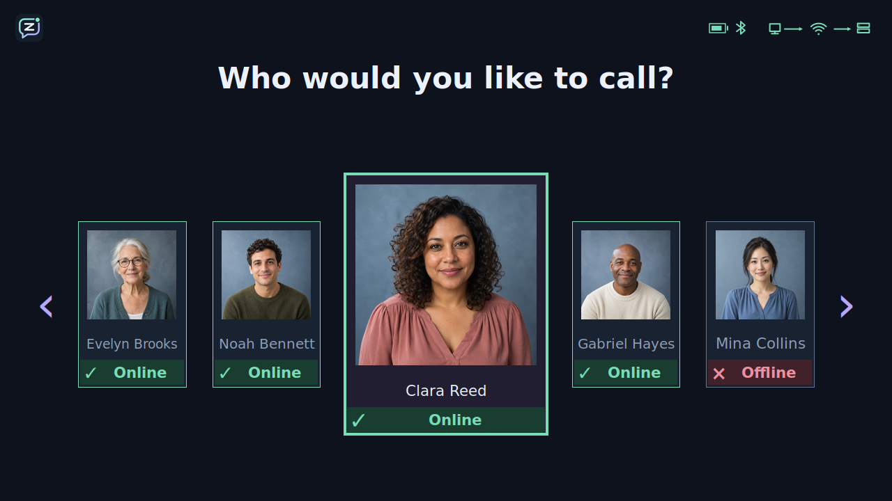
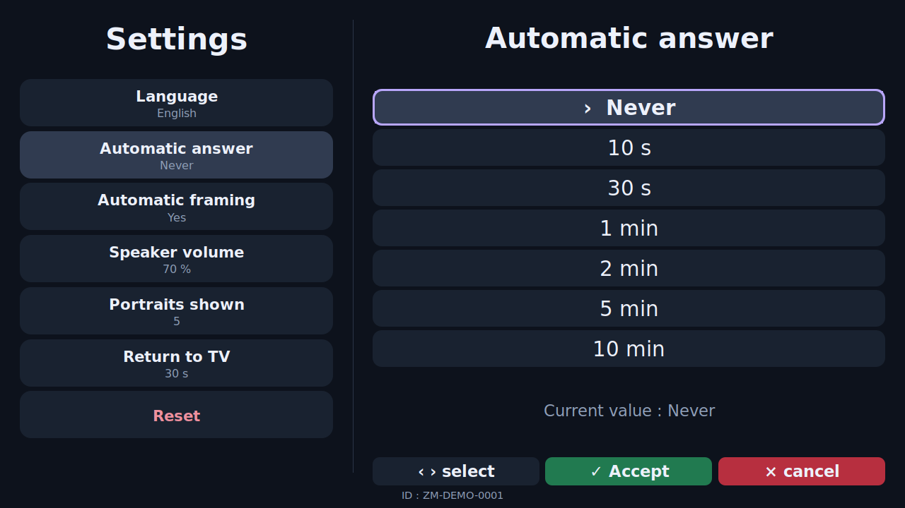
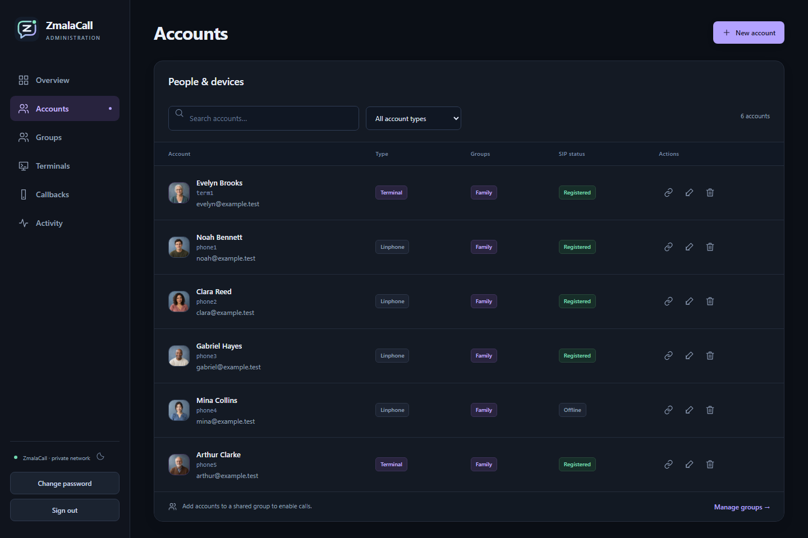

<p align="center">
  
</p>

<h1 align="center">ZmalaCall</h1>

<p align="center"><strong>Family video calls, made for the TV.</strong></p>

<p align="center">
  <a href="https://github.com/toastfr35/ZmalaCall/actions/workflows/verify.yml"></a>
</p>

<p align="center">
  <a href="#get-started">Get started</a> ·
  <a href="https://github.com/toastfr35/ZmalaCall/releases/latest">Releases</a> ·
  <a href="#guides">Guides</a> ·
  <a href="https://github.com/toastfr35/ZmalaCall/issues">Report an issue</a>
</p>

ZmalaCall turns a Raspberry Pi and a television into a video-call terminal.
Choose a familiar face with the remote, confirm the call, and talk on the big
screen. It is designed for people who prefer a few physical buttons to a phone
or computer interface.

A separate Raspberry Pi server lets an administrator manage contacts, settings
and devices from a web browser. A Windows terminal and compatible SIP phone
clients can also join the same local network.



*The current terminal interface. Screenshots on this page use fictional demo
contacts and simulated device status, rendered by the actual application.*

## Built around simple calls

- **Faces instead of numbers.** Browse three or five portraits at a time. See
  who is available, missed calls and pending callback requests.
- **A few physical controls.** Left and right select a contact; green confirms
  or answers; red cancels or ends a call. Hold the middle button and move the
  Presenter+ remote to adjust volume.
- **Video that fills the TV.** See the other person with your own camera in a
  small inset. Optional automatic framing keeps people in view, with a maximum
  2× zoom. Resolution and frame rate can be set for each terminal.
- **Help with the television.** On compatible HDMI-CEC TVs, the terminal can
  wake the screen, select its input and restore the previous TV state after
  calls or a configurable idle period.
- **Guided first use.** Screens help connect the camera, pair and test the
  remote, scan Wi-Fi and server QR codes, and check TV control.
- **Settings for each person.** Choose the language, automatic-answer delay,
  framing, speaker volume, portrait count and return-to-TV timeout.

## Settings without a keyboard

Use the same remote to change settings on the TV. Arrow buttons select an option,
green accepts it, and red cancels the change. Accepted settings are saved back
to the server.



## Manage from a phone or computer

The browser interface brings accounts, portraits, contact groups and terminal
settings together. Check device and call status, manage callback requests,
download setup QR codes, and back up or restore server data.



## How it fits together

The **terminal** provides the TV interface, remote controls, camera, microphone
and speaker. The **server** holds accounts and settings, connects calls through
SIP, and relays their audio and video. It does not record or transcode calls.
The **admin browser** is used for setup and maintenance.

The default setup is intended for a trusted local network. An optional
[secure relay deployment](docs/server.md#secure-calls-when-a-terminal-network-blocks-udp)
uses TLS and encrypted media to support terminals on networks that block UDP.
It requires configured public endpoints and certificates; HTTPS-only proxies can
still block it. See the [network guide](docs/general.md#network-and-identity) for
ports and deployment boundaries.

## Get started

### Hardware and software

| Component | Current supported setup |
| --- | --- |
| TV terminal | Raspberry Pi 4 Model B, HDMI TV, Nuroum C20 camera/speakerphone and Microsoft Presenter+ remote |
| Terminal case | Argon ONE Pi 4 V2, with automatic fan integration |
| Server | Raspberry Pi 3 Model B/B+ or Raspberry Pi 4 Model B |
| Pi operating system | Raspberry Pi OS Lite **64-bit**, Debian 13 **Trixie**, for both server and terminal |
| Installation computer | Windows; installers deploy to the Pi over wired Ethernet SSH |
| Desktop terminal | 64-bit Windows with a camera, microphone and speaker or headset |

### Downloads

The [latest public release](https://github.com/toastfr35/ZmalaCall/releases/latest)
contains the published terminal installer. For current development versions,
open a successful workflow run and download its artifact:

- **Terminal:** [Build terminal installer](https://github.com/toastfr35/ZmalaCall/actions/workflows/build-terminal-installer.yml).
  Download `zmala-terminal-setup` and run `zmala_terminal_setup.exe`.
- **Server:** [Build server installer](https://github.com/toastfr35/ZmalaCall/actions/workflows/build-server-installer.yml).
  Download `zmala-server-setup` and run `zmala_server_setup.exe`.

Development artifacts include the Word guides beside the executable. GitHub
[requires sign-in](https://docs.github.com/en/actions/how-tos/manage-workflow-runs/download-workflow-artifacts)
to download workflow artifacts; published release assets can
be downloaded without an account. The installers support a graphical interface
and headless operation.

### From SD card to first call

1. **Prepare the server.** Follow the server guide to flash the supported OS,
   connect Ethernet and run the server installer. Open its web page and create
   your accounts and contact groups.
2. **Prepare the terminal.** Follow the terminal guide to flash its SD card,
   connect the TV and accessories, and run the terminal installer.
3. **Complete setup on the TV.** Pair and test the remote, scan the Wi-Fi and
   server QR codes, and complete the TV-control checks. The server QR code
   assigns the terminal identity.

### Guides

Download the Word document for the task you want to complete:

| Guide | What it covers |
| --- | --- |
| [Prepare a server](docs/server_prep.docx) | SD card, installation, migration and first accounts |
| [Prepare a terminal](docs/terminal_prep.docx) | SD card, physical connections and installation |
| [Configure a terminal](docs/terminal_config.docx) | Accounts, enrollment, TV checks and settings |
| [Use a terminal](docs/terminal_use.docx) | Remote controls, calls, callbacks and everyday help |

## For developers

Start with the [development setup and checks](docs/general.md#development-tools-and-checks).
The implementation guides cover the current code and its component boundaries:

- [System overview](docs/general.md): architecture, networking, builds and verification.
- [Server](docs/server.md): web administration, APIs, SIP/media, persistence and recovery.
- [Terminal](docs/terminal.md): user functions, controllers, native media and Pi hardware.

After installing the development dependencies, run these from the repository root:

```sh
make lint            # Static checks and generated-asset consistency
make test            # Portable requirement-based unit and integration tests
make requirements    # Validate traces and build the searchable requirements report
make coverage-llt    # Measure unit-test coverage separately from other tests
```

`make clean CLEAN_FLAGS=--dry-run` previews temporary-file cleanup. For Windows
terminal instances, use **Start ZmalaCall Terminal.cmd** and
**Stop ZmalaCall Terminal.cmd** at the repository root. Server hosting is Linux-only.

### Requirements and verification

[Doorstop records](requirements/) are the source of product requirements.
Product items lead to themed server and Pi-terminal high-level requirements,
then low-level requirements linked to code and tests. Tests live in
[`tests/server/`](tests/server/) and [`tests/terminal/`](tests/terminal/), with
separate `LLT` unit tests and `HLT` system/integration scenarios.

`make requirements` writes the report to `requirements/output/index.html`.
The [Verify workflow](https://github.com/toastfr35/ZmalaCall/actions/workflows/verify.yml)
also publishes it as the `zmala-requirements` artifact. See the
[requirement rewrite method](howto_rewrite_requirements.md) for the process and
[astra.md](astra.md) for remaining engineering work.
