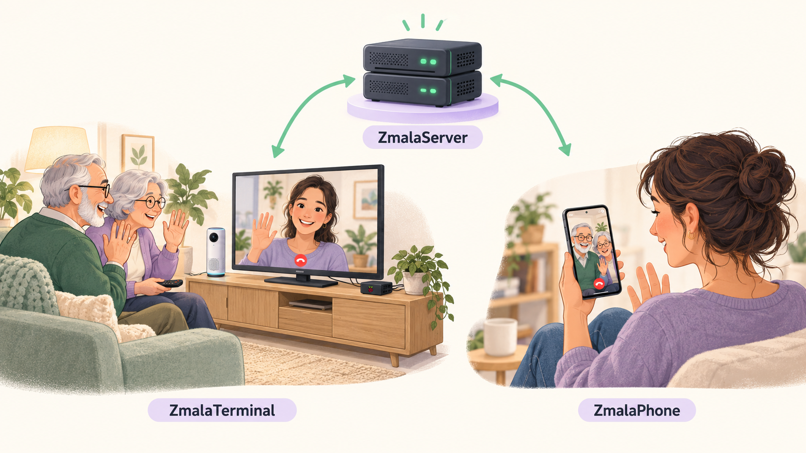

  

<h1 align="center">ZmalaCall</h1>

<strong>Easy family video calls, from the comfort of your sofa.</strong>

  

  <a href="#get-started">Get started</a> ·
  <a href="https://github.com/toastfr35/ZmalaCall/releases/latest">Releases</a> ·
  <a href="#guides">Guides</a> ·
  <a href="https://github.com/toastfr35/ZmalaCall/issues">Report an issue</a>

ZmalaCall brings family and friends onto a familiar TV screen. Settle into your
sofa, choose a familiar face with a small remote, confirm the call and enjoy
the conversation. Family can join from their Android phones or another TV
terminal.

**ZmalaTerminal is designed to make video calling feel comfortable and
approachable.** It suits anyone who feels most at home with a TV and physical
buttons, including older relatives who want an easy way to see the family.
Large portraits, a simplified interface and clear on-screen prompts help each
person call with confidence, at their own pace.

A family member or helper takes care of installation, contacts and preferences.
Once set up, everyday calls need only the TV and remote. Optional automation
takes care of more of the steps, so the person calling can focus on the people
on screen.

*Screenshots on this page use fictional demo contacts and simulated device status.*

## Familiar faces, a few buttons

- **Recognise the person you want to call.** Browse three or five large contact
  portraits at a time, with clear availability indicators.
- **Use the same simple controls throughout.** Left and right choose a contact;
  green confirms or answers; red cancels or ends a call. These same colours and
  buttons guide you through the screens.
- **Enjoy a big picture and hands-free conversation.** See family on the TV
  while the camera, microphone and speaker handle the conversation from the sofa.
- **Keep in touch when the timing isn't right.** Missed-call notices and callback
  requests make it easy to see who wants to talk.
- **Make it feel right for each person.** Choose the language, volume and number
  of portraits shown. Settings can be adjusted as someone's preferences change.

## Let the terminal take care of the extra steps

Automation is configurable, so a family can choose how much help the terminal
provides:

- **Ready after startup.** The calling interface starts automatically when the
  Raspberry Pi boots.
- **Help with the TV.** On compatible HDMI-CEC televisions, the terminal can wake
  the screen, select the correct input and restore the previous TV state after
  a call or a configured idle period.
- **Optional automatic answering.** Incoming calls can be answered after a
  chosen countdown. The person at the terminal can still cancel before it answers.
- **Optional automatic framing.** The camera view can adjust to keep people in
  the picture, helping them stay comfortably seated.

First-time setup is guided on the TV, including connecting the camera, pairing
and testing the remote, scanning setup QR codes and checking TV control.

## Settings without a keyboard

Use the same remote to change settings on the TV. Arrow buttons select an option,
green accepts it, and red cancels the change. Accepted settings are saved back
to the server.

## A helping hand from family

A family member or helper uses the server's browser interface to prepare contact
portraits, choose who can call whom and adjust terminal preferences. This keeps
account management and maintenance separate from everyday calling on the TV.
The same interface shows device and call status, manages callback requests,
provides setup QR codes, and lets the helper back up or restore server data.
Each account is assigned to either an app or a terminal. Give each device its own
account and setup QR code. Server administration is restricted to the server's
local network.

## Call from an Android phone

Install **ZmalaPhone** and scan the setup QR code supplied by your administrator,
on paper or displayed on another screen. You do not need access to the server's
administration page.

Contacts appear as compact rows with a portrait and name. Tap a green name to
start a video call; gray names are unavailable. During a call, tap the video to
show the microphone, audio output, camera-switch and hangup controls. Calls
support portrait and landscape views, with your camera preview in the corner;
the contact screen stays in portrait.
Missed-call and callback icons appear beside contacts. Request a callback for an
offline contact or after an unanswered call. While your request is pending, its
button becomes a cancel button.

The contact screen shows the installed version and an Updates control. Updates
can be downloaded in the app; optional automatic updates on supported phones
wait until the app is idle. Android may ask you to confirm installation.

Allow notifications to receive incoming-call alerts while the app is closed or
the phone is asleep. This requires internet access and Firebase push configured
on the server. After using Android's **Force stop**, reopen ZmalaPhone to receive
calls again.

## How it fits together

The system has three components:

- **ZmalaTerminal:** a Raspberry Pi connected to a TV, camera and remote, for
  simple calls from the sofa.
- **ZmalaServer:** a separate Raspberry Pi that connects calls and lets a helper
  manage accounts, contacts and devices from a web browser.
- **ZmalaPhone:** an Android app so family can join calls from their phones.

The **terminal** and **Android app** provide the calling interfaces. The
**server** holds accounts and settings, connects calls and relays their audio
and video. It does not record calls. An administrator uses a web browser for
setup and maintenance.

The default setup uses a trusted local network. With a publicly reachable server
and secure relay configured, phones and terminals can call from different
networks using encrypted connections. Follow the server installation guide to
configure internet access; some restrictive networks may still block calls.

## Get started

### Hardware and software

| Component | Current supported setup |
| --- | --- |
| TV terminal | Raspberry Pi 4 Model B, HDMI TV, Nuroum C20 camera/speakerphone and Microsoft Presenter+ remote |
| Terminal case | Argon ONE Pi 4 V2, with automatic fan integration |
| Server | Raspberry Pi 3 Model B/B+ or Raspberry Pi 4 Model B |
| Pi operating system | Raspberry Pi OS Lite **64-bit**, Debian 13 **Trixie**, for both server and terminal |
| Installation computer | Windows; installers deploy to the Pi over wired Ethernet SSH |
| Android phone | Android 9 or later, 64-bit ARM or x86 processor, camera and microphone; notifications and internet access for incoming alerts |

### Terminal parts list — United Kingdom

These suggested shopping lists use **GBP (£)** and one of each item. Prices are
indicative UK retail prices checked on **19 October 2026**, including VAT where
shown by the retailer, and excluding delivery. They are budgeting estimates, not
manufacturer recommended retail prices; check the final price and stock before
ordering. Product names link to the example suppliers.

The examples use a **3GB Raspberry Pi 4** and a **32GB microSD card**. The linked 32GB card was
listed as sold out when checked; an equivalent 32GB Class 10 card is suitable. Reuse suitable equipment you already own.

| Item | Suggested part / purchase link | Estimated price |
| --- | --- | ---: |
| Raspberry Pi | [Raspberry Pi 4 Model B — 3GB](https://thepihut.com/products/raspberry-pi-4-model-b?variant=55488357400961) | £80.40 |
| microSD card | [Official Raspberry Pi A2 — 32GB](https://thepihut.com/products/noobs-preinstalled-sd-card?variant=20649315598398) | £27.50 |
| Case | [Argon ONE V2 for Raspberry Pi 4, with fan](https://thepihut.com/products/argon-one-raspberry-pi-4-case) | £24.00 |
| HDMI cable | [Full-size HDMI to HDMI, 2m, with CEC](https://thepihut.com/products/1-8m-hdmi-cable?variant=40821663662275) | £4.00 |
| Camera, microphone and speaker | [Nuroum C20](https://nuroum.com/uk/product/all-in-one-webcam-c20) | £153.00 |
| Remote | [Microsoft Presenter+](https://www.tab-retail.co.uk/microsoft-presenter-certified-for-microsoft-teams-remote-bluetooth/) | £16.99 |
| USB power supply | [Official Raspberry Pi 15W USB-C, UK plug, 5.1V/3A](https://thepihut.com/products/raspberry-pi-psu-uk) | £7.70 |
| Ethernet cable for setup | [RJ45 Cat5e cable, 5m](https://thepihut.com/products/rj45-cat5e-ethernet-lan-cable-5m-black) | £3.00 |
| **Terminal total** | **One complete terminal, excluding the TV** | **£316.59** |

The Argon ONE **V2** converts the Pi's micro-HDMI ports to **full-size HDMI**,
so the cable above fits the case. The C20 includes the microphone and speaker;
there is no separate audio equipment to buy. The Presenter+ price is a discounted
listing and availability varies; check that its charging dock is included.

### Server parts list — United Kingdom

One server can be shared by the family's terminals and phones; you do not need a
server for each person.

| Item | Suggested part / purchase link | Estimated price |
| --- | --- | ---: |
| Raspberry Pi | [Raspberry Pi 4 Model B — 3GB](https://thepihut.com/products/raspberry-pi-4-model-b?variant=55488357400961) | £80.40 |
| microSD card | [Official Raspberry Pi A2 — 32GB](https://thepihut.com/products/noobs-preinstalled-sd-card?variant=20649315598398) | £27.50 |
| Case | [Official Raspberry Pi 4 case](https://thepihut.com/products/raspberry-pi-4-case) | £4.80 |
| USB power supply | [Official Raspberry Pi 15W USB-C, UK plug, 5.1V/3A](https://thepihut.com/products/raspberry-pi-psu-uk) | £7.70 |
| Ethernet cable for setup | [RJ45 Cat5e cable, 5m](https://thepihut.com/products/rj45-cat5e-ethernet-lan-cable-5m-black) | £3.00 |
| **Server total** | **One shared family server** | **£123.40** |

**One terminal plus one server: £439.99**, before delivery. The totals include
two Ethernet cables. Keeping the server connected by Ethernet is recommended.

You will also need an existing HDMI TV, internet connection, a Windows computer
for installation and a microSD card reader. Those items, Android phones and
ongoing electricity/internet costs are not included. Even if a card comes with
Raspberry Pi OS pre-installed, flash the **Lite 64-bit Trixie** image specified in
the installation guide before running the installer.

### Downloads

The [latest public release](https://github.com/toastfr35/ZmalaCall/releases/latest)
contains published installers and instructions. New combined releases use these
download names (older releases may contain only the terminal):

| Product | Installation PDF | User guide PDF | Installer |
| --- | --- | --- | --- |
| ZmalaTerminal | `ZmalaTerminal-Installation.pdf` | `ZmalaTerminal-Guide.pdf` | `ZmalaTerminal-Pi4-setup.exe` |
| ZmalaServer | `ZmalaServer-Installation.pdf` | `ZmalaServer-Guide.pdf` | `ZmalaServer-Pi4-setup.exe` |
| ZmalaPhone | `ZmalaPhone-Installation.pdf` | `ZmalaPhone-Guide.pdf` | `ZmalaPhone.apk` |

Published release downloads do not require a GitHub account. Run the Pi setup
programs on a Windows computer; install the APK directly on your Android phone.
Download the matching PDFs for each product you use.

### From setup to first call

1. **Prepare the server.** Follow the server guide to flash the supported OS,
   connect Ethernet and run the server installer. Open its web page and create
   your accounts and contact groups.
2. **Prepare the terminal.** Follow the terminal guide to flash its SD card,
   connect the TV and accessories, and run the terminal installer.
3. **Complete setup on the TV.** Pair and test the remote, scan the Wi-Fi and
   server QR codes, and complete the TV-control checks. The server QR code
   assigns the terminal identity.
4. **Set up phones.** Create a separate App account for each phone and give its
   user the setup QR code. Install ZmalaPhone, scan the QR and allow camera,
   microphone and notification permissions.
5. **Make a call.** Put the accounts in a shared calling group. Select a contact
   on the TV or tap a green contact name on the phone.

### Guides

Use the PDFs supplied with your release:

| Guide | What it covers |
| --- | --- |
| ZmalaServer Installation | SD card, installation and secure internet access |
| ZmalaServer Guide | Accounts, groups, setup QR codes, backups and maintenance |
| ZmalaTerminal Installation | SD card, physical connections and installation |
| ZmalaTerminal Guide | Enrollment, TV settings, remote controls, calls and everyday help |
| ZmalaPhone Installation | APK installation, QR enrollment and incoming alerts |
| ZmalaPhone Guide | Contacts, calls, camera controls and everyday help |

---

[Developer information](for_developpers.md)
