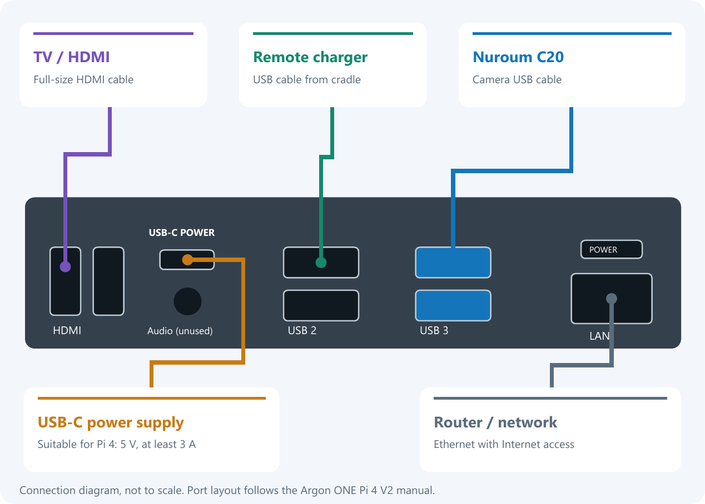
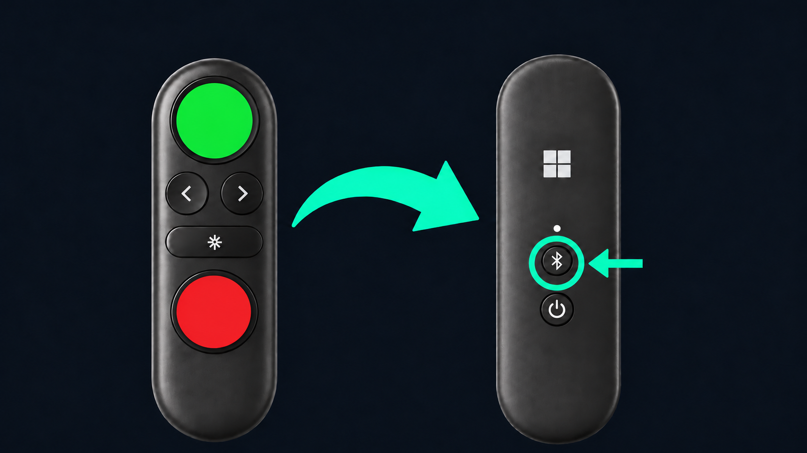

# ZmalaCall terminal

This guide covers the Raspberry Pi TV terminal and the Windows test terminal.
See [general.md](general.md) for project tools and network scope and
[server.md](server.md) for accounts, QR creation and administration.
The shared Python UI and call logic live in `zmala_terminal/common/`; Windows
and Linux adapters live in their respective platform directories.

Contents: [installation](#fresh-raspberry-pi-installation), [first startup/reset](#first-startup-and-reset),
[controls](#settings-and-controls), [remote](#remote-status-and-recovery),
[TV/display](#tv-control-and-display), [media](#video-and-audio),
[services/peripherals](#appliance-services-storage-and-peripherals),
[Windows and architecture](#windowssource-launch-and-architecture),
[troubleshooting](#verification-and-troubleshooting).

## Fresh Raspberry Pi installation

The installer targets Raspberry Pi 4 Model B with Raspberry Pi OS Lite (64-bit),
Debian 13 Trixie, a Nuroum C20 and a Microsoft Presenter+ remote. The Windows
installer includes Argon ONE Pi 4 V2 fan configuration automatically. No desktop
environment, preconfigured Wi-Fi or cloned enrollment is needed.

### Flash and connect

1. Install [Raspberry Pi Imager](https://www.raspberrypi.com/software/) on the PC.
   Select Raspberry Pi OS Lite (64-bit), Debian Trixie, and the intended SD card.
   Writing erases that card; check the selected drive before proceeding.
2. In image customization set hostname, username and initial password to `zmala`.
   Enable SSH with password authentication. Select the correct Wi-Fi country;
   leave Wi-Fi credentials unset for QR-based setup.
3. Finish writing/verification, eject the card and insert it with Pi power off.
4. Connect the C20 to a blue USB 3 socket, the remote charging cradle to the
   adjacent black USB 2 socket, Ethernet to the router and HDMI to the TV.
   On the Argon case use one full-size HDMI socket; leave the other unused.
   A bare Pi uses micro-HDMI. Select that input on the TV.
5. Connect USB-C power last (a suitable Pi 4 5 V, at least 3 A supply). If needed,
   press the case power button once and allow the first boot to finish.



Keep Ethernet with Internet access connected throughout installation. The Windows
PC needs access to the same LAN. `zmala` is the hostname; `zmala.local` is its mDNS
network address. Use the Ethernet IP from the router if name resolution fails.
The terminal's eventual account/serial is assigned by the server QR, not this name.

### Run the Windows installer

Download `zmala_terminal_setup.exe` from the
[latest public release](https://github.com/toastfr35/ZmalaCall/releases/latest),
or the artifact of a successful
[Build terminal installer](https://github.com/toastfr35/ZmalaCall/actions/workflows/build-terminal-installer.yml)
run for an unreleased build. Extract the download before running it.

Click **Check Pi** with `zmala.local` (or its Ethernet IP), then **Install** and
confirm the target. The executable carries its Python/SSH runtime and source
package; no separate PC Python/SSH install is needed. It verifies login/sudo,
Pi 4, Raspberry Pi OS image identity, Trixie/ARM64, boot mount, storage and the
wired route. It pins the SSH host key, verifies the uploaded package, installs
dependencies/services, reboots and checks a new boot ID and stable services.
The verified Ethernet address is retained so Wi-Fi mDNS changes cannot redirect
the installation connection.

**View details** shows progress/errors; **Open saved log** opens the PC log under
`%LOCALAPPDATA%\ZmalaCall\Installer\logs`. Pi installation logs are retained under
`/var/log/zmalacall-install/`. Installation runs as a separate systemd job and
can continue after a dropped SSH/PC connection. Inspect its reported log before
retrying; do not start overlapping installs. Existing enrollment is preserved.
Success verifies startup, not the physical picture, sound or QR acceptance.

### Headless mode and local build

The same executable supports unattended deployment, including reboot:

```powershell
$setup = Start-Process -FilePath .\zmala_terminal_setup.exe `
    -ArgumentList '--headless', '--host', 'zmala.local', '--yes', `
                  '--log', 'C:\Temp\zmala-install.log' `
    -Wait -PassThru
$setup.ExitCode
```

Use `--check-only` instead of `--yes` for a read-only preflight. The GUI executable
needs explicit waiting in scripts. Exit codes: 0 success, 1 check/install/log
failure, 2 invalid arguments or missing consent, 130 interrupted. Without `--log`,
headless logs use the normal installer log directory. Interruption may leave the
Pi job running. QR and physical remote/TV setup still follow on the terminal.

To build on Windows with a Tk-enabled Python:

```sh
python -m pip install -r build_tools/windows_installer/requirements.txt
python build_tools/windows_installer/build.py
```

Output is `build_tools/dist/zmala_terminal_setup.exe`; CI builds/smoke-tests the
same unsigned executable in GUI/headless modes. Installer downloads include the
current Markdown guides and their installation illustrations.

### Manual package installation

From the source checkout on the PC:

```sh
python build_tools/linux/package-terminal.py
scp build_tools/dist/ZmalaCall-Terminal-rpi.tar.gz* zmala@zmala.local:~/
```

Over Ethernet on the Pi:

```sh
sha256sum --check ZmalaCall-Terminal-rpi.tar.gz.sha256
mkdir -p ~/zmala-install
tar -xzf ~/ZmalaCall-Terminal-rpi.tar.gz -C ~/zmala-install
cd ~/zmala-install
sudo ./install.sh --argon-one
sudo reboot
```

Unlike the Windows executable, the shell installer uses `--argon-one` explicitly
for the case. It verifies the archive manifest, physical Ethernet, boot mount,
3 GiB free on `/var` and 128 MiB on `/boot/firmware`; failures identify the stage
and return nonzero. Dependency download failures are fatal. Retrying preserves
enrollment; OS/package changes are not automatically rolled back.

| Shell option | Purpose |
| --- | --- |
| `--user zmala` | Non-root service user; default is `zmala` |
| `--ssh-interface eth0` | Physical wired interface for SSH |
| `--display-mode 1280x720` | Default HDMI desktop; `1920x1080` or `auto` are alternatives |
| `--no-splash` | Leave boot presentation unchanged |
| `--without-framing` | Skip detector installation; leave framing disabled |
| `--data-from PATH` | Explicit migration of missing old state |
| `--bootstrap PATH` | Administrator-supplied connection JSON instead of server QR |
| `--wifi-mode existing-link` | Development-only bypass of joining the scanned Wi-Fi |

Use the system Python on Pi: apt-installed GI, Cairo, Tk and OpenCV are not
automatically visible in a pip virtual environment. The installer supplies Xorg,
Openbox, Picom, BlueZ, NetworkManager, Liblinphone 5.3, native media plugins,
framing runtime/model and fonts. Linux packages include shared/Linux source only.

## First startup and reset

Have the account's Wi-Fi/server QR documents ready from the server's Terminals
page. Stop the old terminal before replacing it with the same enrollment.

1. With no C20, an illustrated screen asks for the camera and charger USB cables.
   It advances when the C20 is detected; the power-only charger itself is not
   detectable. This gate is for enrollment, not an interruption of active calls.
2. With no saved Presenter pairing, switch it on and hold its rear Bluetooth
   button for about three seconds until the white light flashes. The pairing
   service selects one advertising Presenter+ with the HID service; multiple
   matching remotes are not selected silently.
3. Press and release **left, right, green, red, middle** in the shown order.
   Only the requested button is highlighted. Real Presenter reports are required;
   keyboard input cannot pass. All five must pass before camera QR scanning.
   Disconnect resets unfinished progress; passing is saved for that pairing.
4. Show the Wi-Fi QR and wait for connection/success confirmation, then the server
   QR. The latter's version-1 payload contains `server_url`, `device_id` and
   `device_token`. Invalid setup data remains an error/retry state. The displayed
   serial is the server-assigned ID.
5. Complete the localized TV power and input checks below, then make a test call
   and check live video, self-view and intelligible audio in both directions.
   Reboot to check retained identity, reconnection and automatic startup.



Installation starts in English. Server enrollment applies the selected language;
some detailed Bluetooth/TV recovery prompts currently have English/French copy
with English fallback. The same server QR can replace a terminal while its URL,
ID and token remain valid. Changed URL, revoked token or account deletion needs
current enrollment data. Bluetooth and Samsung permissions belong to the new Pi.

Reset is in local Settings, with a separate confirmation. It clears enrollment,
cached configuration, missed counts and setup-test results. Application-owned
Wi-Fi deletion retries across failure/reboot before a new Wi-Fi enrollment;
unrelated network profiles are preserved. Reset requires remote verification
again; it does not delete server accounts. New Linux Wi-Fi profiles disable
power saving. The Wi-Fi icon reports Wi-Fi independently of Ethernet/server access.

## Settings and controls

| Control | Action |
| --- | --- |
| Left/right | Select contacts; navigate settings/options or change a value |
| Green | Open confirmation, call/request/answer, open a setting or accept its draft |
| Red | Cancel/decline/end, cancel a selected callback request, or discard/leave an editor |
| Hold red for 10 seconds on the carousel | Open Settings; progress appears after two seconds |
| Hold middle and move up/down | Relative speaker adjustment: two percentage points per 64 motion units |

Windows equivalents are Left/Right, Enter and Escape. F11 toggles fullscreen
outside confirmation. Button repeat cannot confirm a call; release, another
button, focus loss, disconnect or an incoming call cancels the settings hold.
The Presenter green sticker covers the microphone button; red covers Teams.
Middle is Pointer. Horizontal motion is ignored for volume.

Settings has a list and editor; only the active side shows button hints, status
icons are hidden, and the terminal serial appears at the bottom. Confirmed edits
go back to the server. Failed/conflicting saves retain visible error guidance.

| Setting | Local choices |
| --- | --- |
| Language | Server-supported languages |
| Automatic answer | Never, 10 seconds, 30 seconds, 1, 2, 5 or 10 minutes |
| Automatic framing | On/off; Pi C20 only |
| Speaker volume | 0–100% |
| Portraits | Three/five; short contact lists retain three positions |
| Return to TV | 30 seconds (default), 1, 2, 5, 10, 20 minutes, Never |
| Reset | Confirmed local reset and re-enrollment |

Volume motion shows a vertical bar while held and for two seconds after release;
a red exclamation indicates mixer failure. It changes speaker/ringtone playback,
not microphone gain/mute. Mixer requests coalesce on one worker at at most ten
per second. Motion changes survive calls/core replacement in the current session;
restart or a changed server volume restores the saved setting.

Contact names stay within portrait frames. Online/offline bands use symbols and
words. Green opens a separate call confirmation for an online contact or callback
confirmation for an offline contact; another distinct green press confirms.
Availability is checked again before dialing. Offline contacts stay visible.
Incoming calls interrupt drafts/confirmation without late callbacks overwriting
the ringing screen. Connected calls show remote video and a bottom-right self-view.
Missing remote video shows an explanation without stopping audio/outgoing video.

Pending callbacks have a separate return-arrow badge. Red opens cancellation
confirmation. Requests update only after acknowledgement, and stale polls cannot
restore a cancelled request. Eligible callback contacts may be selected after an
idle interval, but still need call confirmation; there is no automatic callback dial.

Missed incoming calls and authenticated phone texts share per-contact unread
counts. Merely browsing preserves them; opening that contact's confirmation clears
its count, even when cancelled. Connecting an incoming call also clears its count.
Answered/locally declined/outgoing calls do not create missed counts. Bodies are
not displayed or stored. Counts persist by SIP account/domain and are pruned for
removed/ineligible contacts. The corner badge totals them; values over 99 display
as `99+` while exact counts remain stored.

## Remote status and recovery

Bluetooth is green when Presenter input devices are open, red/slashed when
unavailable, grey where monitoring is unsupported (including Windows). The idle
recovery page appears after five seconds without input availability and clears
automatically on recovery; it does not wake the TV or supersede a call.
Background checks distinguish absent pairing, disabled adapter, blocked device
and connected-but-unready input. A disconnected remote cannot be reliably
classified as switched off, out of range, flat or faulty; the help explains
switching it on and charging it.

Battery is green above 20%, amber at 11–20%, red at 0–10%, and unknown if stale
or unavailable. Five-second checks expire after 20 seconds without an update.
The lightning bolt uses the Presenter's measured charger-connection HID report;
it indicates external power, including at full charge, not measured charging current.
Unsupported report shapes remain unknown.

For manual pairing recovery, stop `zmalacall-pairing` to avoid competing agents.
Unblock Bluetooth with `sudo rfkill unblock bluetooth` if needed, start
`bluetoothctl --agent NoInputNoOutput`, select `default-agent`, `power on` and
`scan on`, then pair/trust/connect the currently advertised Presenter address.
Keep the agent running until completion; stop discovery and restart the pairing
service afterward. A pairing-mode address can change. Moving an SD card to a
different Pi does not transfer the Bluetooth controller identity.

## TV control and display

The first mapped button when TV power/input hides the UI wakes/selects the
terminal and is consumed, as are presses while HDMI settles. It cannot also dial
or change contacts. This includes the first middle/Pointer press: motion during
that consumed hold does not adjust volume. Release and press again to adjust it.
With no CEC, normal button behavior remains available; unknown routing limits
detection.

Incoming calls remember observed power/source before revealing the UI. Decline,
caller cancellation or hangup restores that state. Browsing has its own return
timeout: button activity resets it, a thin blue bar appears after ten seconds
idle, and expiry restores the captured state. Calls and pending saves suspend
the timer. Volume/mute are not changed by CEC. Unknown previous input is not guessed.

### Installation TV checks

After server enrollment the wizard pauses media startup and idle restoration.
Green starts the standby/wake test; a three-second off interval follows a bounded
standby-report wait. The user confirms whether the picture went off and returned.
For input testing, switch to another channel/input with the TV remote. The wizard
detects departure, returns to ZmalaCall, restores the previous source, then returns
again, allowing three seconds between commands. Select the input manually if it
does not return within 30 seconds. Green confirms success; red offers recovery/retry
or manual operation. CEC acknowledgements alone do not count as a pass.

`/var/lib/zmalacall/<profile>/tv-check.json` stores attempts, performed/results/
skips, completion, EDID hash and HDMI address. Save failures block completion.
Interrupted tests resume at a prompt, not another automatic power command.
A changed TV/route invalidates previous results on startup; reset clears them.
Failed/skipped features are disabled independently; keep the TV remote available.

Samsung recovery covers Anynet+/Network Control, local discovery and permission
approval. The user selects among discovered TVs. The fallback stores private
`tv-remote.json` credentials with mode 600 and a pinned TLS certificate, and sends
`KEY_TV` for the remembered tuner source. A power-toggle fallback is used only
after rechecking a settled on-state, never for unknown/transitional/off status.
It does not restore arbitrary smart-TV apps.

Some Samsung models need a verified HDMI key bound to their actual physical
address, for example `"terminal_source":{"address":"1.0.0.0","key":"KEY_HDMI"}`.
The wizard saves it only after the user confirms the complete round trip.
`KEY_HDMI1` and `KEY_HDMI` are not interchangeable on every model. Cable moves
invalidate the binding; changed TV address/certificate requires pairing again.
For manual recovery, run `build_tools/linux/pair-samsung-tv.py <TV-IP>` as the
terminal service user and approve the TV prompt. Removing the private credential
file disables network fallback without removing CEC.

Sony BRAVIA uses standard CEC, not Samsung commands. Enable BRAVIA Sync control
and TV auto power on, and check its device list under External inputs (menu names
vary). Older models call this Control for HDMI/HDMI CEC. Physical BRAVIA operation,
especially tuner restoration, has not been qualified; use the wizard's actual
picture checks rather than assuming protocol support guarantees switching.

### HDMI presentation

HDMI desktop resolution is independent of transmitted call resolution. The kiosk
defaults to 1280×720 near 60 Hz when advertised, avoiding a 4K desktop; the shell
installer can select 1080p or auto. Plymouth displays the logo/family word cloud;
firmware/HDMI negotiation may still produce brief blank screens. Original boot
files are saved as `*.before-zmala`; rescue consoles remain on other VTs.

The kiosk owns display `:0`/VT7 and disables a competing desktop display manager.
Picom uses XRender/VSync with fullscreen composition. Supported Pi 4 Xorg drivers
receive the `msdri3` override in `/etc/X11/xorg.conf.d/21-zmalacall-pi4.conf` to
permit synchronized page flips; Tk buffering alone did not prevent scanout tearing.
The override is board/driver-specific. The Xorg 21.1 driver does not implement
the newer `TearFree` option. Carousel animation uses absolute 60 Hz deadlines,
skipping missed deadlines; this is not a guaranteed 60 fps rendering rate.

CEC adapter selection prefers connected EDID-bearing outputs, then enabled
scanout, retaining the current adapter when disconnected for standby wake.
An explicit observer `--device` stays fixed; saved restoration is not redirected
mid-call. Check TV input, cable, EDID, display service and observer selection before
forcing HDMI boot modes. A fresh supported image is preferable to Pi 3 migration
settings, which can retain obsolete display and Bluetooth configuration.

## Video and audio

Fresh profiles use 720p at 15 fps. Each terminal independently selects 480p
(640×480), 720p (1280×720) or 1080p (1920×1080), with 10/15/20/25/30 fps targets.
Legacy 360p maps to supported 480p. Media graph changes wait until idle;
framing and speaker volume have live controls.

| Resolution | Upload budget at 15 fps (kbit/s) | Receive allowance (kbit/s) |
| --- | ---: | ---: |
| 480p | 700 | 2000 |
| 720p | 1500 | 4000 |
| 1080p | 2500 | 6000 |

Upload is `ceil(base × target_fps / 15)`; receive allowance is independent of the
local FPS to support a faster peer. These are SDK bandwidth allowances, not
reserved network bandwidth or guaranteed quality. Camera exposure, scene detail,
codec/UI work and network jitter affect delivered frames. Read actual capture,
negotiated and decoded dimensions/rates, not just configuration or transmit counters.

Linux uses explicit C20 MJPEG capture, Pi `bcm2835-codec` H.264 encoding and
FFmpeg software H.264 decoding. It does not silently choose another camera or
HDMI audio when the C20 is absent. Camera format/size checks avoid the SDK's
YUYV/VGA fallback. Windows retains server-selected SDK devices and H.264/VP8;
its local OpenH264 receive adapter preserves valid NAL bytes that the bundled
adapter corrupted. Pi peers use H.264. Hardware decoding is not the current path.

Capture keeps the latest pending frame. JPEG decode, framing and preview reduction
run on a separate worker with one waiting JPEG and one completed picture. The
H.264 decoder uses two threads and ordered compressed queues; arbitrary compressed
frame dropping would corrupt references. Encoding reuses buffers and scales only
when input/target sizes differ. Encoder overflow recovers with fresh headers;
recovery requests are coalesced. Queue count/age diagnostics exist; byte budgets
and bounded stuck-native shutdown remain outstanding.

The local preview shares camera capture, averages pixels before final display
scaling and uses NEON for common 2×/4× reductions with scalar fallback. Small
frames avoid another reduction copy. Drawing occurs for new frames/state changes
plus a 250 ms recovery refresh, rather than every empty ticker pass.
Current short Pi 4 checks established two-way 1080p20 when the peer camera exposure
could supply 20 fps; they do not qualify sustained 30 fps or uniformly low latency.
An old 15 fps observation is not a hard limit. Low-light exposure can limit capture
below its advertised format rate; a faster server does not fix that bottleneck.

C20 microphone input is 16 kHz stereo; playback is 48 kHz stereo. The speech
profile limits echo processing to the native input rate while retaining the
48 kHz Opus clock and playback resampling. Normal processing remains selectable.
Echo cancellation uses a 500 ms window/automatic delay; assess real speech before
changing it. Packet counters alone do not establish intelligibility or acoustic
echo performance. Earlier USB/control timeouts require separate capture/audio
diagnosis; changing codec bitrate cannot repair a stalled physical device.

### Automatic framing

Framing defaults off, is per-terminal and currently supports the Pi C20 only.
Windows leaves its view unchanged. The detector samples the uncropped picture
every two seconds, frames the group with margin, and limits digital zoom to 1–2×.
Zoom-in needs stable observations; new people outside the crop widen promptly.
Pan/zoom ease over about two seconds. Temporary misses retain people for six
seconds; no people or detector failure returns wide, with an eight-second native
watchdog. New calls start wide and discard previous session results.

At 2×, a 1080p source contains only a 960×540 crop enlarged to the output; digital
zoom adds no optical detail. People on a TV or in a photo can be detected too.
No images are normally saved or sent to the server for inference.

The installer prepares LiteRT 2.3.0 and a checksum-pinned SSD MobileNet V2 COCO
quantized model (Apache-2.0, 300×300 input). A lower-priority process uses two
inference threads and one replaceable thumbnail slot; media never waits for it.
Session/sample tokens reject old results after toggles, size changes or calls.
The MJPEG worker crops YUV once for preview and encoder. With framing off/wide,
decoded frames pass through without a crop copy. CPU affinity is not restricted.
Repair an omitted/broken runtime from the installed project using
`sudo sh build_tools/linux/setup-auto-framing.sh`, then restart the terminal.
Source archives omit downloaded models/runtime; calls never download them.

## Appliance services, storage and peripherals

```sh
sudo systemctl status zmalacall-terminal zmalacall-display zmalacall-pairing
sudo systemctl restart zmalacall-terminal
sudo systemctl stop zmalacall-terminal zmalacall-display
sudo systemctl start zmalacall-display
sudo journalctl -u zmalacall-terminal -u zmalacall-display -b
```

Use `disable --now` for both terminal/display services to disable autostart.
Display controls the separate compositor; CEC and pairing have separate services.
Application failures restart automatically, while explicit stops stay stopped.
Code is root-owned under `/opt/zmalacall/releases`; private state is in
`/var/lib/zmalacall`. `current` changes after preparation and `previous` retains
the old release. This is not transactional rollback of OS/configuration/data.

SSH is Ethernet-only after installation. Its nftables guard covers configured
ports, IPv4/IPv6 and traffic arriving over Wi-Fi even if addressed to Ethernet.
Preserve its include/service dependencies. The application runs without root;
scoped Polkit, input permissions and fixed-action helpers handle required hardware.

Journals are volatile/capped at 64 MiB; zram replaces SD-backed swap, `/tmp` is
RAM-backed and root uses `noatime`. Locks/status live under `/run/zmalacall`.
Enrollment, Bluetooth/Wi-Fi, settings, photos and SDK security databases remain
persistent. Export logs before reboot. To enable bounded verbose diagnostics:

```sh
python3 /opt/zmalacall/current/build_tools/linux/diagnostics.py 10
sudo journalctl -u zmalacall-terminal -f
python3 /opt/zmalacall/current/build_tools/linux/check-low-wear.py
```

Diagnostics expires after the selected minutes (maximum 60) or restart; use `0`
to stop early. The filesystem remains writable; this is not a read-only overlay.

### Argon fan

The Windows installer enables fan control; manual installs use `--argon-one`.
It is off outside connected calls, 55% during calls and 100% at 65°C during calls.
Hangup/stop requests fan-off. Reads/writes run off the UI thread. There is no
outside-call thermal override; firmware throttling remains active. Only I2C bus 1,
address `0x1a`, duty values 0–100 are used. Power-button/IR/vendor power-mode
software is not installed. An enabled competing `argononed` causes install refusal.

### Optional USB power control

This experiment is not enabled by the regular installer. The Pi 4's external USB
ports switch together, including the C20 and charger. It cuts power only after
five idle camera minutes with a fresh remote battery reading strictly above 25%.
Calls/ringing/setup/settings, low/unknown battery or a stale app heartbeat restore
or retain power. Another peripheral or open media handles blocks shutdown.
Do not use with USB storage; disable before attaching extra equipment to an
unpowered port, where it cannot yet be detected.

Enable on a matching installed release:

```sh
sudo sh /opt/zmalacall/current/build_tools/linux/install-usb-power.sh zmala
sudo systemctl restart zmalacall-terminal
```

The helper deauthorizes C20 interfaces before switching; wake waits for camera/
audio enumeration, refreshes SDK devices on their owning thread and reapplies
volume. Operations run off-thread and fail toward power-on. A stop hook restores
power after app exit. Status is `/run/zmalacall/usb-power.json`. Wake adds device
startup latency before auto-answer; no electrical energy-saving claim is made.

Disable while preserving power:

```sh
sudo systemctl stop zmalacall-terminal
sudo /usr/local/libexec/zmala-usb-power on
sudo rm /etc/systemd/system/zmalacall-terminal.service.d/usb-power.conf
sudo systemctl daemon-reload
sudo systemctl start zmalacall-terminal
```

## Windows/source launch and architecture

`Start ZmalaCall Terminal.cmd` prepares the Windows runtime and starts the regular
profile; `-Fullscreen` is optional. `-Unconfigured` uses a separate fresh QR
profile, and `-ConnectWifi` makes that profile join the scanned network instead
of validating the existing link. `Stop ZmalaCall Terminal.cmd` stops both managed
profiles, checking executable/start time before using recorded PIDs. It does not
stop the server or directly launched Python processes. Direct entry:

```sh
python -m zmala_terminal.common.main --fullscreen --bootstrap /path/to/terminal.json
```

Use a separate `--profile NAME` for another instance and different account
credentials for simultaneous registrations. Connection JSON contains
`server_url`, `device_id`, `device_token`; keep it private and use the reachable
Linux server, not a stale localhost bootstrap. Windows runtime is Liblinphone
5.4.98 with Tk, ANGLE graphics bridges and OpenH264; dependencies remain in
`build_tools/runtime`. Source state remains in `zmala_terminal/data/`.

| Shared modules (under `common/`) | Responsibility |
| --- | --- |
| `main.py` | Own state/resource lifetimes and compose controllers |
| `input_control.py`, `settings_control.py`, `idle_return.py` | Input/repeat handling, drafts/hold and TV timeout |
| `model.py`, `call_control.py`, `management.py` | Call/notification state, async actions, polling and timers |
| `configuration.py`, `config_validation.py`, `configuration_control.py` | HTTP validation/cache and idle engine replacement |
| `setup_flow.py`, `provisioning.py`, `remote_test.py`, `tv_check.py` | Enrollment/reset and persisted setup verification |
| `ui/`, `theme.py`, `icons.py`, `text_renderer.py` | Display, confirmation, carousel and platform rendering |
| `engine.py`, `linphone_api.py`, `native_runtime.py` | Shared native ABI/call engine and platform loading |
| `qr_scanner.py`, `qr_worker.py`, `native_qr.py` | Isolated camera process and preview protocol |
| `maintenance.py`, `process_job.py`, `volume_control.py` | Command ownership, process cleanup and mixer worker |

`Terminal` owns shared state; controllers do not keep independent state copies.
Tk and core iteration run on the UI thread. Native media owns worker/ticker
threads; HTTP/Wi-Fi results return through queues. Generation/serial checks discard
late results after reset, cancellation or replacement. Native callbacks/DLL handles
remain referenced until their core closes; borrowed call pointers are explicitly
retained/released. Shutdown is idempotent, though SDK/QR waits can still block.

Configuration polls and settings responses share validation, rollback rejection
and stable-cache policy; presence/callback fields are not persisted every poll.
Authenticated HTTP rejects redirects. Failed engine setup retains the newest
desired configuration for idle retry after five seconds, without publishing it as
successfully applied. QR capture is isolated from native decoder failure and
releases the camera before the call engine acquires it.

Text uses GDI+ on Windows and Pango/Cairo/Noto on Linux, including complex-script
shaping. LRU pixel budgets are 8 MiB text, 32 MiB rendered portraits, 24 MiB source
portraits and 2 MiB icons; Linux adds 8 MiB flattened backgrounds. Active widget
references and transient/native allocations are outside these budgets. Before
portrait decoding, PNG/JPEG headers are limited to 2 MiB encoded, 4096 per side
and 4,194,304 pixels total. Invalid images fall back to initials. Photo downloads
use one worker, a 40-path queue, atomic publication and one-minute failure backoff.

## Verification and troubleshooting

Portable tests do not operate the TV or prove native SDK compatibility. For real
rendering use `zmala_terminal/common/tests/render_cache_ui.py` (Linux under Xvfb);
`--benchmark` measures synthetic cache pressure. UI probes such as `settings_ui.py`,
`tv_setup_ui.py` and `terminal_languages_ui.py` exercise layouts without CEC.
`build_tools/linux/test-video-workers.sh` checks JPEG workers, preview pixels,
framing, stale tokens and UBSan paths; a Pi run additionally covers ARM NEON.
Hardware encoder/decoder probes in `build_tools/linux/test-video-*.c` and Windows
`build_tools/tests/h264_decoder_native.py` need their respective native SDKs.

Live fixtures under `common/tests/` can use real cameras/accounts: read their
entry points first, use disposable accounts, and stop any normal terminal whose
registration/camera would conflict. Launcher integration tests start/stop actual
Windows terminal windows. Restore normal services and volume after tests.

| Symptom | First checks |
| --- | --- |
| No TV image | Power/input/cable, `zmalacall-display`, EDID and selected HDMI/CEC adapter |
| Remote unavailable | Charge/power, BlueZ pairing/adapter state, pairing service and input-device readiness |
| Server QR rejected | Current URL/token/ID, reachable server, correct QR and account association |
| Pixelated/slow video | Actual negotiated/captured dimensions, exposure, bitrate, CPU/thermal state, jitter/loss |
| No C20 audio and video | Kernel USB errors and independent capture/audio probes before blaming SIP or codecs |
| Call connected but no sound | Selected devices, actual decoded levels and physical listening in both directions |
| Old backup rejected | Follow server re-enrollment recovery; do not disable revision checks |

Long idle/repeated calls, USB reconnect/power faults, network loss, CEC across TV
models, echo/listening and intended-user readability still need physical acceptance.
Keep failures distinct from old tests on different hardware. Remaining engineering
work is in [astra.md](../astra.md).
