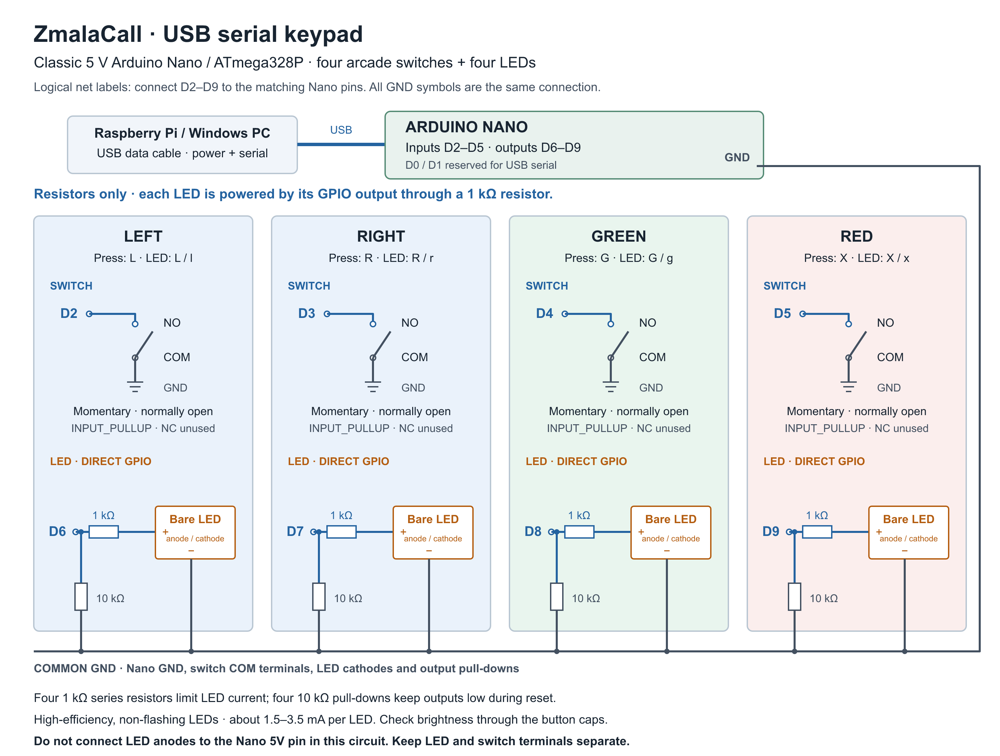

# ZmalaCall keypad specification

Date: 6 October 2026. Status: Nano firmware implemented and tested with simulated inputs; compiled for ATmega328P with both Nano bootloader settings. Physical hardware testing and terminal serial integration remain to be done.

Files: [Arduino sketch](firmware/ZmalaCallKeypad/ZmalaCallKeypad.ino), [editable wiring diagram](wiring.svg), [high-resolution diagram](wiring.png), and [firmware tests](tests/firmware_test.cpp).

The selected circuit drives replacement bare LEDs directly through resistors. Its electronic parts are:

| Part | Quantity |
|---|---|
| Classic 5 V Arduino Nano / ATmega328P | 1 |
| Momentary arcade switch/button assembly | 4 |
| High-efficiency bare LED fitting the button holder | 4: one red, one green, two for navigation |
| 1 kΩ, ¼ W series resistor | 4 |
| 10 kΩ, ¼ W output pull-down resistor | 4 |

Use the existing LEDs if they provide adequate brightness with this circuit; otherwise replace them. No additional active components are needed.

## Purpose

Provide four large illuminated physical controls for the terminal: left, right, green and red. Use a classic **Arduino Nano with ATmega328P, 5 V logic**, connected to the Raspberry Pi by one USB data cable. The cable supplies power and exposes the Nano's USB serial port. The same protocol shall work with the Windows terminal.

Call handling, confirmation and factory-reset decisions remain in the terminal application. The Nano handles switch scanning, debounce, serial communication and lamp outputs. No Wi-Fi, Bluetooth or battery is required.

## Hardware and wiring

Required parts:

- One classic Arduino Nano, with a working USB-to-serial interface and a USB data cable matching its connector.
- Four arcade buttons, each containing an independent normally-open momentary switch. Replace the original lamps if necessary with **high-efficiency bare LEDs** that fit the button's lamp holder and give adequate brightness at a few milliamps. Use steady, non-flashing LEDs. Two navigation buttons carry permanent left/right arrow symbols; the other buttons are green and red with appropriate call/confirm and cancel/hang-up symbols.
- Four **1 kΩ** series resistors and four **10 kΩ** output pull-down resistors, 5% tolerance or better; ordinary ¼ W resistors are sufficient.
- Wiring and a mechanically secure enclosure with USB strain relief and a non-slip base. The main circuit requires no transistors or MOSFETs.

The four switches shall connect independently between their input pin and GND. Use `INPUT_PULLUP`: released is HIGH, pressed is LOW. Where a microswitch has COM, NO and NC terminals, use COM and NO only.

| Control | Switch input | LED output | Protocol letter |
|---|---|---|---|
| Left | D2 | D6 | `L` |
| Right | D3 | D7 | `R` |
| Green | D4 | D8 | `G` |
| Red | D5 | D9 | `X` |

`X` means cancel/red; `R` is already assigned to right. D0/RX and D1/TX shall remain unused by buttons or lamps because they serve USB serial communication.

For each LED, connect the output pin through a **1 kΩ series resistor** to the LED's anode (+). Connect its cathode (−) to GND. Also connect a **10 kΩ resistor from the output pin to GND**, on the GPIO side of the series resistor; this holds the output low while the board resets. All grounds are common. HIGH turns the LED on. Do not connect the LED's anode to the Nano's 5V pin in this direct-drive circuit.

The 1 kΩ resistor is required even for a bare LED. Current is approximately `(GPIO output voltage − LED forward voltage) / 1000 Ω`, normally about **1.5–3.5 mA**, depending on colour and output voltage. The 10 kΩ pull-down adds about 0.5 mA to the GPIO load while on. With a supply no higher than 5.25 V and 5% resistors, even a shorted LED draws less than **7 mA total from one output pin**. Four outputs together remain below 28 mA, comfortably within the Nano's specified [20 mA per-pin limit](https://docs.arduino.cc/resources/pinouts/A000005-full-pinout.pdf) and the relevant [ATmega328P port-current limits](https://docs.arduino.cc/resources/datasheets/Atmel-42735-8-bit-AVR-Microcontroller-ATmega328-328P_Datasheet.pdf).

Use LEDs whose brightness is adequate at this low current, not lamps that require a full 5 V supply or an active LED controller. A passive 5 V LED module with a built-in resistor can also be tried with the external 1 kΩ resistor left in place, but it will usually be dimmer. If replacing lamps with bare LEDs, check polarity and ensure their leads cannot contact the switch terminals. Switch and LED connections shall remain separate.

The complete keypad, including all four LEDs on, shall draw no more than **150 mA from USB**; measure the assembled device. No external supply or Pi GPIO connection is required. A 12 V arcade lamp is not suitable for the direct-drive circuit.



The main diagram uses logical Nano pin names, not the positions of pins on a breadboard. The protocol, pin assignments and firmware are unchanged by the simpler LED circuit.

### Optional brighter-lamp circuit

If low-current LEDs are not bright enough through the button caps, use the earlier [MOSFET driver diagram](wiring-mosfet.svg) ([PNG](wiring-mosfet.png)). This alternative supplies passive 5 V lamp modules directly from USB-derived 5 V and switches their cathodes with four logic-level N-channel MOSFETs. Each gate uses a 220 Ω series resistor and 10 kΩ pull-down. Bare LEDs still need appropriate series current limiting; the alternative diagram assumes the lamp modules already include it.

Select parts whose on-resistance is specified at a gate voltage of 4.5 V or less, rated for the actual lamp current. For example, see the [AO3400A datasheet](https://www.aosmd.com/res/data_sheets/AO3400A.pdf); this surface-mount part needs a suitable adapter for hand wiring. D, G and S on the diagram mean drain, gate and source, not physical lead order. Confirm the selected component's pinout. Both circuits use HIGH for on and require the same firmware. The optional driver circuit is only needed if the resistor-only circuit's brightness is insufficient.

## Physical construction and usability

- Use switches with clear tactile feedback and modest operating force. Evaluate 30–50 mm button caps with the intended users before choosing the final size.
- Keep navigation controls separate from green/red call controls. Permanent symbols shall identify each control even when its lamp is off; colour alone shall not be the only distinction.
- Use a stable, weighted or non-slip enclosure with rounded edges, protected internal wiring and cable strain relief. Users shall be able to press a button without moving the enclosure.
- Use a USB cable that carries data as well as power. A charging-only cable cannot carry serial events.

The four independent switch inputs avoid a key matrix and its ghosting issues. The GPIO wiring stays inside the keypad.

## Serial transport

Use **9600 baud, 8 data bits, no parity, 1 stop bit (8N1)**, with software and hardware flow control disabled.

Every message is exactly **one ASCII byte**. There are no newline characters, separators, packet headers or multi-byte commands. Both ends process each byte independently, including when several arrive in one read. Production firmware shall send no debug text on this port. Unknown bytes, including CR and LF, are ignored without a response or state change.

### Keypad to terminal: physical presses

| Byte | Meaning |
|---|---|
| `L` | Left button pressed |
| `R` | Right button pressed |
| `G` | Green button pressed |
| `X` | Red button pressed |
| `!` | Response to a connection/heartbeat query |

Send one event when a switch becomes stably pressed. Do not send release events or repeat events while held. Release is detected internally and is required before another press of that button can be reported.

### Terminal to keypad: lamp control

| Lamp | On byte | Off byte |
|---|---|---|
| Left | `L` | `l` |
| Right | `R` | `r` |
| Green | `G` | `g` |
| Red | `X` | `x` |

Uppercase means on, lowercase means off. Each command sets an absolute state; it never toggles. Repeated commands are harmless. The two directions use the same letters independently: receiving `G` lights the green lamp and must never generate a green press event.

The terminal may also send `?`. The keypad responds with `!` and renews the active connection. These are the only control bytes beyond the per-button letters. There is no LED-command acknowledgement, replay or press-event retransmission.

Examples:

- Keypad sends `G`: the user pressed green once.
- Terminal sends `lrGX`: navigation lamps off, green and red lamps on.
- Terminal sends `lrgx`: all four lamps off.
- Terminal sends `?`; keypad responds `!`: connection is responsive.

## Button scanning and firmware behaviour

Scan all switches at least once every 5 ms. Debounce each independently: accept a changed state only after it has remained unchanged for **30 ms**. Apply the same debounce to press and release. Use elapsed-time checks, not blocking delays, so serial processing and other switches continue to work.

After startup or connection timeout, suppress press events until a `?` has arrived and all four switches have been stably released. A button held during power-up or reconnection must not cause an action. Ignore presses during this initial release period; do not queue them for later.

For genuinely simultaneous presses accepted in one scan, send events in a fixed order: left, right, green, red. There are no button combinations, macros or hardware mode changes.

All LEDs shall start off, including during reset. The output pull-downs keep them off while GPIO pins are unconfigured. Lamps change only through host commands or the connection-timeout rule; pressing a button does not change its lamp automatically.

The terminal sends `?` once per second. If no `?` arrives for **5 seconds**, firmware turns all lamps off, disables press reporting, discards pending events and returns to the initial-release state. Lamp commands received while disconnected are ignored; a new `?` re-establishes the session. An unknown byte must not renew the timeout.

The firmware bounds serial processing to eight input bytes per scan and checks TX capacity before writing, keeping switch scanning responsive. Under abnormal serial-output congestion it drops a press instead of blocking or replaying it later. Normal traffic at the specified baud rate does not approach that limit.

## Build, upload and bench check

### Arduino IDE

1. Open `keypad/firmware/ZmalaCallKeypad/ZmalaCallKeypad.ino` in Arduino IDE. The sketch uses only the Arduino core; no extra libraries are needed.
2. Install **Arduino AVR Boards** through Boards Manager if necessary. The tested core version is **1.8.8**.
3. Select **Arduino Nano** and **ATmega328P**. For a Nano with the older bootloader, select **ATmega328P (Old Bootloader)** instead. This changes the upload settings; the button wiring and serial protocol are identical.
4. Select the board's port and upload. Release the port from any terminal application or serial monitor first.
5. Open Serial Monitor at **9600 baud** with **No line ending** and wait two seconds for startup. Send `?`; expect exactly `!`. Send `LRGX` to turn all lamps on, or `lrgx` to turn all off. Send `?` at intervals shorter than five seconds to keep the session active. Press/release each switch and expect `L`, `R`, `G` or `X`. The monitor supplies heartbeat only when you send it manually.
6. Stop sending queries: after five seconds all lamps shall turn off and button events stop. Reconnect with `?`, release all buttons and test a fresh press.

### Command-line build on this PC

From the project root, run:

```powershell
./build_tools/build-keypad.ps1
./build_tools/build-keypad.ps1 -Processor atmega328old
```

The script uses Arduino CLI, installs the pinned AVR core into `build_tools/runtime/arduino/`, and writes `.hex` files into `build_tools/dist/keypad/<processor>/`. It builds only; it does not upload to a board. If CLI is unavailable, install it using the [official Arduino CLI instructions](https://docs.arduino.cc/arduino-cli/installation/) or use Arduino IDE above.

### Firmware tests and diagram regeneration

The tests compile the actual sketch against a small simulated Arduino core. With a C++11 compiler available, run from the project root:

```powershell
New-Item -ItemType Directory -Force build_tools/tmp/keypad | Out-Null
g++ -std=c++11 -Wall -Wextra -Werror -I keypad/tests keypad/tests/firmware_test.cpp -o build_tools/tmp/keypad/firmware-test.exe
./build_tools/tmp/keypad/firmware-test.exe
```

The tests exercise debounce, distinct presses, held buttons, LED commands, session expiry, reconnect, simultaneous inputs, serial congestion and timer rollover. They do not replace electrical or physical USB tests.

`python keypad/draw-wiring.py` regenerates `wiring.svg` using only the Python standard library. The PNG is a 2960 × 2240 rendering of that SVG. Use the SVG for printing at other sizes. `python keypad/draw-wiring.py --mosfet` regenerates the optional brighter-lamp SVG.

## Terminal integration and reconnect

The terminal shall have a local setting for the serial device: a configured COM port on Windows, or a stable `/dev/serial/by-id/…` path on Linux where available. A physical USB path may be used for devices without unique serial identifiers. Do not assume a fixed `/dev/ttyUSB0`, and do not probe unrelated serial devices automatically.

Only one process may own the port. Firmware uploads or use of the Arduino serial monitor require releasing it from the terminal first. The OS must provide the driver for the chosen Nano's USB-to-serial chip, and the terminal user must have permission to open the port.

Opening a classic Nano serial port can reset it. On open, discard stale received data, wait at least **2 seconds** for startup, discard data again, then send `?`. Continue querying once per second until `!` arrives. Ignore press bytes before that response. On connection, send all four lamp states from the current application screen; do not depend on previous lamp state.

Read serial input without blocking the Tk/UI thread. Queue valid press events and dispatch them on the UI thread through the existing logical `left`, `right`, `green` and `red` action handler. Each byte is a complete physical press; it must not enter the keyboard held-key path, which requires key-release events. Serial input must work independently of window focus.

The terminal shall disconnect and retry if the port fails or no `!` arrives for 5 seconds. Discard unread/queued events belonging to the old connection before retrying. Reopen attempts occur no faster than once every 2 seconds and shall not interrupt rendering, QR scanning or an active call. Never replay presses from an earlier connection.

Existing keyboard controls remain available for development: Left and Right navigate, Enter acts as green, and Escape acts as red. Unlike serial input, these keyboard controls require UI focus. Both input paths shall use the same application action rules.

Send a complete lamp snapshot after each relevant UI state change and after reconnect. Blinking, if desired, is produced by host on/off commands; the initial protocol provides steady lamps only.

## Lamp meaning

A lit lamp indicates a currently relevant action. An unlit lamp is guidance, not an electrical lockout: firmware shall still report the button so the application remains responsible for interpreting it.

| Screen/state | Left/right | Green | Red |
|---|---|---|---|
| Idle carousel | On when navigation can change the selected contact | On when the selected contact can open call or callback confirmation | Off |
| Call or callback confirmation | Off | On | On |
| Callback submission or acknowledgement | Off | Off | On only while cancellation is supported |
| Incoming ringing call | Off | On when manual answering is available | On |
| Outgoing call or connected call | Off | Off | On |
| Factory-reset confirmation | Off | On | On |
| QR setup, including the Wi-Fi success pause | Off | Off | Off |

Derive availability from the current terminal state and its existing action rules. Call and callback confirmations still cancel on any other button. On the idle screen, ten distinct red presses within ten seconds still open factory-reset confirmation even though the red lamp is normally off. A held red switch counts once; a held green switch cannot both open confirmation and confirm a call.

## Acceptance checks

1. Confirm wiring, lamp polarity and total USB current with all lamps on; verify all lamps stay off during startup and reset.
2. Verify each press byte and each lamp command on both Windows and Raspberry Pi OS. Test a read containing several bytes and commands sent without newlines.
3. Verify switch bounce causes one event, and a 30-second hold causes no repeat. Release and press again shall produce one new event.
4. Verify ten deliberate red presses in ten seconds work only from idle; holding red never triggers factory reset.
5. Verify the two-green confirmation flow requires two separate physical presses.
6. Verify lamp commands never produce press events, and unknown bytes leave state unchanged.
7. Start or reconnect with a button held: no action occurs until all buttons are released and a new press is made.
8. Stop heartbeat while USB remains powered: within 5 seconds all lamps turn off and presses stop being reported. Restore heartbeat, release all buttons and verify fresh operation.
9. Unplug/replug, reset the Nano and restart the application during idle and during a call. No stale event shall place, answer or end a call; lamps shall restore from current application state.
10. Confirm serial input remains responsive without UI focus and while rendering, networking and camera setup are active.
11. Confirm intended users can distinguish all four controls and press them comfortably without moving the enclosure. Check LED brightness through the button caps in normal room lighting; use the optional MOSFET circuit if adequate brightness cannot be achieved with low-current LEDs. Test incoming calls, call/callback confirmations, navigation and factory-reset confirmation with the physical keypad.

## Hardware references

- [Classic Arduino Nano documentation](https://docs.arduino.cc/hardware/nano/): board and USB serial hardware.
- [Arduino Serial.begin reference](https://docs.arduino.cc/language-reference/en/functions/communication/serial/begin/): serial speed and 8N1 configuration.

The pin assignments, character protocol, lamp policy, timing and current budget above are ZmalaCall design choices.
