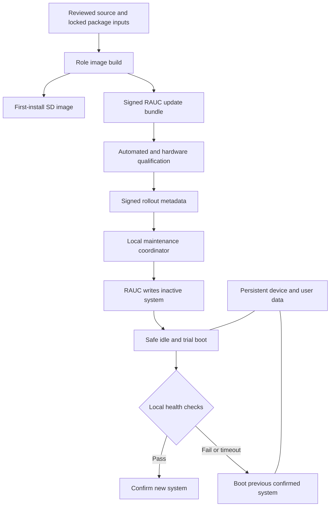

# SD-card installation and automatic system updates and upgrades

Planning issue: [#138](https://github.com/toastfr35/ZmalaCall/issues/138).
Prepared against `main` at `c6aabe2109e8478c6c3b1e6c7564fb7d2f651d7f`
(Zmala 0.3.76), on 4 November 2026.

**Status: implementation started; feasibility and development tooling in progress.** This file records the intended
architecture, work sequence, unresolved engineering decisions and acceptance
evidence. It does not describe functionality already shipped. Its checklists are
uncompleted work, not passed verification. Product requirements remain exclusively
in `requirements/`; implementation changes will add or revise those records and
their direct LLT/HLT coverage before the corresponding behavior ships.

### Implementation log

4 November 2026 — [#140](https://github.com/toastfr35/ZmalaCall/issues/140):

- Added `build_tools/images/` source pins/acquisition, explicit role/package intent,
  minimal A/B boot-probe configuration, bounded read-only Pi inventory and offline
  root privacy inspection. Source downloads are verified before safe extraction;
  neither the sample backend nor a generic mark-good service is installed.
- Collected private read-only inventories from both current Pi roles. Both report
  Debian 13 ARM64. Terminal and server application trees occupy approximately
  0.97 GiB and 0.58 GiB respectively, including retained releases. Some private
  terminal data/checkpoint trees were unreadable without elevated access and are
  marked incomplete. These figures do not establish future root/card fit.
- Audited the pinned native backend: selector commit uses a temporary file/rename
  without explicit durability handling; its example mark-good unit precedes any
  Zmala health checks. Production adoption is blocked on a qualified replacement
  or demonstrated safe integration. The upstream A/B image layer also persists
  per-slot `/var` and enables persistent journals; do not adopt that policy unchanged.
- Selected reviewed imagegen/backend audit revisions in `sources.lock.json` and
  Debian RAUC `1.13-3+deb13u1` as the initial package candidate. Transitive package
  locking and upstream feature qualification are still pending.
- Verified both generated probe configurations through the pinned upstream
  configuration resolver in WSL. The probes do not include the Zmala application
  and have not been built/booted as complete images. Added tool regression checks
  and a CI profile-validation step; runtime requirements remain unchanged.
- Hardware available: spare SD card, no spare Pi. Later physical tests need an
  arranged card swap on an existing Pi, retaining the original card. No live
  installation, service restart, TV or USB power operation was performed.

Stages 0 and 1 are **not complete**. In particular, no production image, package
closure lock, hardware boot qualification or automatic system updater is claimed.

4 November 2026 — continuation of #140:

- Added offline probe-disk validation of primary/backup GPT checksums/agreement,
  partition bounds/identities/order, nonoverlap and equal A/B sizes. It reads only
  regular image files and explicitly does not qualify boot or payload integrity.
- Installed image-builder prerequisites in WSL and started a real minimal ARM64
  filesystem build under emulation. Host utilities and layer resolution passed;
  the first build is still being investigated, not accepted as a finished image.
  Cross-build success will not substitute for physical boot testing.
- Observed that upstream's default Git-derived artifact version can inherit the
  parent checkout's tags. Production assembly needs explicit image/build identity.

## Contents

- [Outcome and scope](#1-outcome-and-agreed-direction)
- [Existing implementation and impact](#3-existing-implementation-and-impact-inventory)
- [Architecture and ownership](#4-target-architecture-and-ownership)
- [SD-card layout and persistent state](#5-sd-card-layout-and-storage-policy)
- [Boot selection and power-loss recovery](#6-boot-selection-trial-and-power-loss-recovery)
- [Data compatibility and major OS upgrades](#7-data-compatibility-and-major-os-transitions)
- [Image creation and first boot](#8-first-install-image-build-and-first-boot)
- [Automatic scheduling and call protection](#9-automatic-maintenance-policy-and-call-protection)
- [Progress, health and recovery](#10-progress-health-and-recovery-experience)
- [Trust and diagnostics](#11-trust-feed-security-and-persistent-history)
- [Builds, promotion and distribution](#12-release-production-security-intake-and-distribution)
- [Legacy coexistence and migration](#13-coexistence-and-migration-from-todays-installations)
- [Requirements and documentation](#14-requirements-traceability-and-documentation-work)
- [Verification](#15-verification-strategy-and-acceptance-evidence)
- [Implementation stages](#16-ordered-implementation-stages)
- [Completion criteria](#17-completion-criteria)
- [Sources and outstanding decisions](#18-reference-sources-and-decisions-still-to-validate)

## 1. Outcome and agreed direction

Replace the normal SSH-based installation process with two complete, public,
ready-to-flash SD-card images:

- **Zmala Terminal:** Raspberry Pi OS, terminal application, media runtime,
  supported hardware integration, setup UI and automatic system maintenance.
- **Zmala Server:** Raspberry Pi OS, server application, required services,
  local first-run administration and automatic system maintenance.

The installation experience becomes: download the correct image, flash and verify
the card with Raspberry Pi Imager, insert it into the Pi, power on, and complete
guided setup. A normal installer does not need an SSH client, Linux shell,
factory SSH password, package installation command or remote upload job.

Updates are automatic as soon as practical, without a per-device administrator
approval queue. The system updates the OS, distribution packages, dependencies and
Zmala application as a tested unit. That includes qualified transitions to later
major OS releases, not just packages within the current Debian release.

Use an A/B system layout and signed RAUC bundles: prepare the inactive system,
boot it as a bounded trial, and retain the last confirmed system until the new
one passes health checks. Keep device identity and user data outside the system
images. The engineering objective is unattended recovery from interrupted
updates, including power loss, within a documented and physically tested failure
model. Neither a second partition nor a signature alone proves that objective.

Initial implementation uses the existing Raspberry Pi OS/Debian base. There is
no initial move to Yocto, Buildroot, containers or another application runtime.
Evaluate those only if a concrete build or safety constraint requires it.

## 2. Scope and boundaries

### 2.1 Included

- Initial SD-card partitioning, reproducible build inputs and image assembly.
- Terminal and server first-boot identity, setup and recovery behavior.
- Signed automatic system updates, minor updates and major OS upgrades.
- Kernel, device-tree, modules and boot-partition firmware shipped as a matched
  system set; application/native dependency compatibility.
- Maintenance admission, call protection, progress, boot health, rollback,
  persistent history, key rotation and release withdrawal.
- Package/security update intake, candidate qualification and staged promotion.
- Migration from both current SSH-installed products to new cards.
- Replacement release downloads, installation guides, tests and requirement traces.
- Shared infrastructure with role-specific health and maintenance adapters.

### 2.2 Excluded from routine system-image installation

- Repartitioning an in-service card over the network.
- Updating the Pi EEPROM bootloader as an ordinary root-filesystem update.
- TV firmware, C10/C20 firmware, Presenter+ firmware and router firmware.
- Remote shell commands supplied by a release feed or administrator browser.
- Arbitrary unqualified packages/plugins installed onto a production root.
- Automatic factory reset or automatic erasure of enrollment after an error.
- Recovery from electrically failed/counterfeit storage, every possible SD
  controller failure, physical theft, or a compromised already-running root user.
- Guaranteeing service availability while the only server is rebooting.

EEPROM compatibility is checked during image qualification and first installation.
If an EEPROM change is necessary, provide a separate, explicitly qualified
procedure and recovery instructions. Root A/B rollback cannot undo a damaged
EEPROM. A future automatic EEPROM mechanism needs its own safety case.

## 3. Existing implementation and impact inventory

Review these owners before implementation. Reuse proven policies and tests where
possible; do not transplant assumptions from application-only updates unchanged.

| Current owner | Current behavior | Planned treatment |
| --- | --- | --- |
| `build_tools/windows_installer/`, `build_tools/server_installer/` | Windows GUI/headless tools upload and install over Ethernet SSH | Retire from the normal new-image installation path after migration qualification; retain historical release downloads |
| `build_tools/linux/install-kiosk.sh`, `install-server.sh` | Change a running OS, install packages, establish services and release symlinks | Extract declarative image provisioning from live-host installation; never run these whole scripts as first-boot installation |
| `build_tools/linux/dependencies.txt` | Terminal distribution dependencies | Become a locked image package input with exact resolved package inventory |
| `build_tools/linux/install-low-wear.sh` | RAM logs, RAM-only swap and storage settings | Retain policy in the image with tests for the new mounts |
| `build_tools/linux/install-ssh-guard.sh`, `install-developer-access.py` | Wired SSH restrictions and separate developer tunnel | Preserve security behavior; remove dependency on SSH for initial installation |
| `build_tools/linux/build-turn.py` and native build tools | Media/TURN corrections tied to the installed SDK | Build inside the matching target image environment and requalify ABI changes |
| `zmala_terminal/linux/update_*.py` | Application-only signed slots, leases, data checkpoints, independent supervisor/display | Reuse concepts and suitable components; image-installed terminals have one system update owner |
| `zmala_terminal/common/update_client.py` | App maintenance handshake and status | Adapt to the system-maintenance contract; legacy deployments continue using the old contract |
| `zmala_server/terminal-updates.js` | Cached app feed, terminal status and admission fencing | Add explicit installation-type/system status, preserving old terminal behavior during coexistence |
| `build_tools/release/{assemble,github_release,terminal_update}.py` | Exact release asset allowlist, notes, app-update signing | Introduce image/bundle/feed artifacts and role-aware publication validation |
| `.github/workflows/{verify,release}.yml` | PR verification and merge-triggered public releases | Add image candidate build/verification and separate qualified system-feed promotion |
| `docs/terminal-update-plan.md`, `docs/terminal-update-qualification.md` | Existing application-only design and evidence | Keep accurate as legacy scope; cross-link the replacement when implemented |

Both current Pi installers target Raspberry Pi OS Lite 64-bit, Debian 13 Trixie.
Terminal installation accepts Pi 4 Model B. Server installation accepts Pi 3 Model
B/B+ and Pi 4 Model B. This plan initially qualifies Pi 4 for both roles; Pi 3
server support is a separate explicit qualification gate, not silently withdrawn
or assumed from portable tests. Public compatibility labels must distinguish
legacy installer support from qualified new-image support.

Current durable terminal data is `/var/lib/zmalacall`; server data is
`/var/lib/zmalacall-server`. Current app-update state also uses
`/opt/zmalacall-updates`, `/var/lib/zmalacall-update-data` and
`/etc/zmalacall/updater.json`. Current roots are writable; `/tmp`, normal journals
and swap are deliberately volatile. The new design must not lose the small
amount of update history needed after a reboot.

The terminal TURN build currently checks MediaStreamer version `5.3.105`.
This is an actual compatibility dependency, not an instruction to freeze security
updates forever. A library change requires requalifying/replacing the patch and
rebuilding the complete image before promotion.

## 4. Target architecture and ownership



Use four clear responsibilities:

1. **Image builder:** constructs known package and application states, public
   first-install images, unsigned candidate payloads and provenance.
2. **Release publisher:** verifies candidate evidence and signs bundles/rollout
   metadata using release-only credentials. It does not inherit trust from an
   untrusted PR artifact merely because its filename looks correct.
3. **Local system-maintenance coordinator:** discovers applicable updates,
   reserves resources, enforces idle/call policy, controls reboot/trial deadlines,
   and records results. An unprivileged application cannot choose raw devices,
   arbitrary URLs, hooks or shell commands for this service.
4. **RAUC and boot integration:** install the verified inactive slot group and
   perform narrowly defined boot selection/confirmation. Data migration and
   product readiness remain explicit Zmala responsibilities.

Prefer RAUC's D-Bus interface for service integration. Inspect the pinned RAUC
version before relying on optional facilities such as polling or adaptive
downloads; current upstream documentation is not proof those features exist in
the distribution package selected for the image.

Implement shared host maintenance outside the terminal UI package so the server
does not import Tk, camera, Bluetooth or TV code. Suggested organization, subject
to the first architecture PR:

```text
build_tools/images/                 # Build configs, package locks, assembly
build_tools/images/common/          # Shared appliance layers and mount policy
build_tools/images/terminal/        # Terminal-specific image layers
build_tools/images/server/          # Server-specific image layers
zmala_system/                       # Small common Pi system-maintenance runtime
  coordinator.py                    # State machine and bounded scheduling
  trust.py                          # Verified metadata and compatibility decisions
  storage.py                        # Fixed layout discovery and space budgets
  boot.py                           # Qualified boot backend adapter
  health.py                         # Shared trial/checkpoint coordination
  terminal.py                       # Terminal readiness and idle adapter
  server.py                         # Server readiness and call-drain adapter
tests/support/system_update/        # Fault injection and common fixtures
tests/adhoc/image_installer/         # Image/flash/build/deployment checks
```

These paths are proposals, not existing modules. Split further only where an
owner has a distinct trust boundary, lifecycle or independently testable policy.
Avoid one large root script and avoid frameworks that obscure boot decisions.

## 5. SD-card layout and storage policy

### 5.1 Proposed layout

Use one versioned partition schema for both roles, with role-specific contents.
The following is an initial sizing budget for a nominal 32 GB card, not a measured
fit guarantee:

| Partition | Initial budget | Contents and policy |
| --- | --- | --- |
| Boot selector/config | 64 MiB | Minimal boot-selection files; immutable except through the qualified commit mechanism |
| Boot A | 512 MiB | Slot A firmware, kernel/initramfs and matching command line |
| Boot B | 512 MiB | Slot B equivalents |
| Root A | 8 GiB | Complete OS, package database, Zmala and native artifacts |
| Root B | 8 GiB | Alternate complete system |
| Data | Remaining usable space | Identities, selected host state, application data, bounded update metadata/cache/checkpoints |

A nominal 32 GB card provides about 29.8 GiB before layout/filesystem overhead;
this example leaves roughly 12 GiB for data. Measure both images, the largest
supported portrait/photo collection, bundle staging, migration checkpoints and
free-space reserve. Adjust budgets before freezing schema v1. Reject cards below
the measured minimum byte capacity even when their label says 32 GB.

RAUC treats the boot and root members of each system as a group. An update is
eligible for trial only after all members have been written and verified. Root
and boot members must not be mixed across slots. Root filesystem paths and boot
configuration use validated stable identifiers, not assumptions that every
device is `/dev/mmcblk0`.

The initial card format decision must resolve Pi 4 firmware compatibility with
the selected MBR/extended or GPT layout and six partitions. Do not copy a sample
GPT configuration without booting every supported board revision. Pin and test
the image tool's chosen format. Partition creation belongs to image generation,
not a field update.

### 5.2 Root and boot mount behavior

- Prefer read-only production roots and boot partitions in ordinary operation.
- Keep the inactive root and boot members unmounted except for controlled
  installation or inspection.
- Keep `/run`, `/tmp` and ordinary journals in RAM; retain RAM-only swap policy.
- Inventory services that write under `/var` or `/etc`. Give each an explicit
  persistent or temporary destination instead of sharing all of `/var` or `/etc`.
- Keep `/var/lib/dpkg`, package alternatives, installed libraries and package
  configuration defaults inside their own system slot. They must roll back
  together. Never bind-mount a shared package database into both systems.
- If read-only roots require an `/etc` overlay, use a slot-specific generated
  upper layer or narrow bind mounts. Never reuse an uncontrolled writable upper
  layer across major OS generations.
- Disable automatic card-expansion behavior that expands a root into the other
  slots. Only the final data filesystem may be expanded, using a resumable,
  separately tested first-boot step. Ship enough preformatted data capacity to
  recover if expansion has not completed.
- Measure write amplification, download/verification throughput and memory use
  on the lowest supported Pi, not only on the build host.

### 5.3 Persistent state inventory

Mount durable state below a single appliance data mount, for example `/data`,
with narrow bind mounts preserving established application paths.

| State | Planned persistence and recovery |
| --- | --- |
| Terminal enrollment, account token, settings, language, history | Preserve through updates; bind to `/var/lib/zmalacall`; versioned validation/checkpoints |
| Server accounts, groups, SIP credentials, portraits, callbacks, photos, admin credentials | Preserve through `/var/lib/zmalacall-server`; consistent backups and trial migration rules |
| Hostname and device identity | Generate once and persist; no shared machine identity in public images |
| NetworkManager Wi-Fi profiles and DHCP identity | Preserve explicitly with root-only permissions; regenerate version-specific representation when needed |
| Bluetooth pairing keys and remote identity | Preserve explicitly; validate BlueZ representation across major versions |
| SSH host keys and authorized recovery identities | Generate once per device; preserve so updates do not trigger host-key changes |
| TV pairing tokens, TV plugin configuration and case configuration | Preserve validated settings; new plugin code comes from the signed system image |
| Local TLS keys, certificate renewal accounts, mail credentials and push sender key | Root/service-restricted data; never in the factory image or public evidence |
| TURN/SIP relay configuration and credentials | Preserve selected secrets; regenerate service configuration for the new slot version |
| Device-managed display/audio/USB policy | Persist validated product settings, not arbitrary copied boot files |
| RAUC status and coordinator transaction records | Durable, bounded and writable only by their owning privileged services |
| Download cache, thumbnails, disposable logs | Bounded and evictable; no identity depends on their survival |

Preserve service UIDs/GIDs consistently across images and migrations. The current
terminal service account and developer tunnel account have different purposes;
do not merge their privileges when normalizing image accounts. Preserve the
server's existing unprivileged service ownership. Inventory every secret location
before deciding backup completeness.

## 6. Boot selection, trial and power-loss recovery

### 6.1 Boot backend decision and release gate

Prototype the Pi's native `tryboot` A/B mechanism first. It is closer to the
existing firmware boot path and avoids adding U-Boot without evidence it is
needed. There is a community RAUC custom backend for this mechanism, but it is
not a substitute for our own audit, pinning, tests and maintenance ownership.

**The shared boot selector is the critical qualification gate.** Native examples
commit a successful trial by updating `autoboot.txt` on FAT. Replacing that file
is not, by itself, demonstrated power-cut-safe storage. Filesystem rename and
`fsync` calls do not automatically prove firmware-readable recovery after a torn
FAT or SD-controller write.

Before choosing this backend for production:

1. Inspect all selector writes, ordering, flushes, fallback selection and
   interrupted-confirmation behavior in the pinned implementation.
2. Establish how firmware finds a valid boot target if the selector file or its
   metadata is damaged. Do not assume undocumented firmware fallback behavior.
3. Test physical interruption during selector creation, replacement and final
   confirmation, including repeated cuts across offsets/timings.
4. Demonstrate normal boot after removal and restoration of mains power, watchdog
   reset, warm reboot and crash, not only successful `reboot` commands.
5. Verify every supported Pi revision and minimum EEPROM version; read
   device-tree boot properties with their documented binary representation.

If this cannot meet the recovery contract, adopt a qualified RAUC-supported
bootloader configuration such as U-Boot with redundant, checksummed boot state,
or another demonstrated recoverable selector design. That alternative also needs
actual power-cut tests and a way to recover the bootloader itself. Do not claim
that adding U-Boot automatically solves all SD write failures.

No automatic stable rollout until this decision has supporting evidence. Factory
image development can proceed while boot safety is being investigated.

### 6.2 Trial sequence

1. Validate current slot identity, installed layout and confirmed-release record.
2. Reserve enough storage and verify a role/hardware-compatible signed bundle.
3. Mark only the inactive system unconfirmed and write its complete slot group.
4. Flush writes, complete integrity checks and durably record the candidate.
5. Obtain final maintenance admission; make/check data checkpoints as required.
6. Persist the intended trial and expected boot identity before requesting it.
7. Request a one-shot trial boot. Keep the old confirmed default until success.
8. An early boot service validates the actual boot/root pairing and mounts data
   before starting application writers. Establish watchdog coverage before the
   stages it is expected to protect.
9. Run bounded local health and migration checks under maintenance fencing.
10. Confirm the system using the qualified boot backend and reconcile the durable
    transaction. Only then remove maintenance and admit normal activity.
11. On failure or deadline, record the reason if possible and restart to the
    previous confirmed system. Reconcile data before that old application starts.

Configure RAUC so completing an inactive-slot installation does not immediately
make that candidate the permanent default. Verify the selected version's
activation/mark-primary semantics explicitly. Installation, one-shot trial and
durable confirmation are separate operations under the coordinator; generic
"mark good on every successful boot" services must not bypass the product health
and data transaction.

One candidate receives one boot trial per installation attempt initially. A
failed digest is quarantined locally and not reinstalled every hour. A signed
newer repair or an explicitly authorized signed retry policy may clear that state.

Confirmation is a transaction spanning boot state and coordinator metadata.
Specify which durable facts are authoritative at each interruption point. A
confirmed boot with an old coordinator record and a trial boot with a new record
must both recover deterministically; do not infer selection from one JSON file.

### 6.3 Watchdog ownership

RAUC/tryboot cannot reset a hung system merely by selecting another partition.
Use the Pi hardware watchdog with a single defined owner and bounded service
health supervision. Distinguish firmware/early-kernel, initramfs and userspace
coverage: systemd's runtime watchdog starts too late to prove recovery from every
earlier boot hang. Qualify a supported early-boot watchdog path or document and
close that gap before making a full unattended-boot-recovery claim.

Set trial, shutdown and runtime timeouts from measured worst-case startup on
supported hardware, including filesystem recovery. Initial budgets may start at
three minutes for a terminal trial and five minutes for a server trial, but are
tuning proposals. Bound each individual check and the overall trial. Never pet
the watchdog indefinitely while the candidate repeatedly restarts the same
failing service.

### 6.4 Failure behavior matrix

| Interruption or fault | Intended result | Evidence needed |
| --- | --- | --- |
| Download, network loss or cache full | Continue confirmed system; retain only safe partial cache | Bounded retry, no boot-selection change |
| Signature, role, board or compatibility mismatch | Reject before selecting candidate | Negative trust/compatibility fixtures |
| Inactive boot/root write fails or power disappears | Old confirmed system remains selectable; partial candidate never trialed | Inject errors/cuts during each member write |
| Power loss after candidate staging but before trial | Boot confirmed default; recover staged record without guessing | Restart at every transaction boundary |
| Trial boot kernel/init/service hang | Watchdog/reset returns to confirmed system within qualified bound | Real hangs at early and late boot stages |
| Trial data migration fails or is interrupted | Previous readable data and confirmed system restored before normal writers | Migration interruption matrix |
| Power loss while marking good | Resolve to one complete valid system using qualified commit semantics | Physical selector/metadata cut tests |
| Missing network, phone, TV, remote or camera | Product reports normal availability problems; avoid pointless OS rollback | External-fault health tests |
| Candidate fails after successful confirmation | Record degraded health; bounded recovery; automatic rollback only if retained data is still compatible | Post-confirmation compatibility scenarios |
| Shared data cannot mount or both roots are invalid | Enter minimal recovery state; do not format or reset identity | Recovery-media and diagnostics exercise |
| EEPROM or SD hardware failure | Follow separate bootloader/card recovery procedure | Documented limits and recoverable backup |

## 7. Data compatibility and major OS transitions

### 7.1 Default rule: rollback-readable persistent data

For ordinary unattended releases, both the candidate and previous confirmed
system can read data written during and after the transition. Prefer additive
fields, preserved unknown fields, versioned serialization and expand/contract
migrations. Delay removal of obsolete representations until no supported
rollback path needs them.

Compatibility covers host services too: NetworkManager, Bluetooth pairing, TLS
state, account permissions and relay configuration can change across OS versions
even if Zmala's own JSON schema does not.

Each signed system description records supported data schema ranges and any
migration generation. Test both directions with real fixtures from supported
source releases. A successful `/ready` or JSON parse is not sufficient proof that
the previous version can safely write the resulting data.

### 7.2 Exceptional incompatible migrations

An unattended upgrade with an unavoidable incompatible migration is eligible only
after a dedicated migration design and qualification. Proposed mechanism:

1. Freeze application mutations and drain owned jobs after maintenance admission.
2. Create a consistent, durable, validated checkpoint with enough free space for
   both the source and destination. Keep schema/version and transaction binding.
3. Migrate into a separate versioned data generation, leaving the old one intact.
4. Trial the candidate against its generation, with externally visible writes
   blocked until confirmation.
5. Commit the boot/data choice through a reconciled state machine; interrupted
   commits must identify the correct pair without destructive guessing.
6. After confirmation, permit normal writes. Retain the old generation for the
   documented recovery interval, but do not silently restore it later and lose
   newly created accounts, calls, callbacks or configuration.

If rollback after service reopening cannot preserve new data, do not advertise
automatic post-confirmation rollback for that release. Roll forward with a repair
or enter an explicit recovery procedure. Initial production support may reject
incompatible migration releases until this mechanism is implemented; that is a
reported eligibility failure, not a claim that major upgrades are supported.

Server backups must be consistent across its JSON files and media. Copying live
files independently while the server writes is not a valid checkpoint. No
restored console job, notification, callback delivery or queued developer command
is replayed merely because an OS rollback occurred.

### 7.3 Major OS release policy

- Build the next major OS in a fresh target root using new locked repositories;
  never change the running Pi's APT sources and run `dist-upgrade` remotely.
- Qualify the native media ABI, all kernel/device drivers, host-service state,
  updater protocol, data compatibility and boot sequence as a new system baseline.
- Express a supported source-version range. If a very old device needs an
  intermediate bridge image, publish a signed bounded upgrade path.
- Reject a bundle requiring a different partition layout; major OS support must
  not depend on in-field repartitioning. Supply a new-card migration if it cannot
  fit the frozen layout.
- Promote a major release only after canary/soak evidence. Once promoted, eligible
  devices upgrade automatically at safe idle; the owner does not approve each Pi.
- Continue providing current-baseline security candidates until the successor is
  qualified where practical. Expose end-of-support and blocked-upgrade conditions
  instead of leaving the fleet silently frozen.

## 8. First-install image build and first boot

### 8.1 Image builder

Use `rpi-image-gen` as the first candidate builder, pinned to a reviewed revision.
It supports customized Raspberry Pi images and provides useful A/B layers. Its
slot-mapping helpers are building blocks, not the entire RAUC safety policy.
Compare a minimal working image with our required six-partition format before
committing to its exact layers.

Prefer a clean native ARM64 Debian/Raspberry Pi OS build environment. An isolated
ARM64 CI worker or ephemeral builder is preferable to placing public PR jobs on
the production terminal/server. Cross-build/QEMU under Linux/WSL can help local
development, but qualifies as a build route only after repeatability tests. The
Windows PC remains a development/flashing host, not a live target needed for
every package installation.

Separate build-time package acquisition from first boot:

1. Resolve trusted Debian/Raspberry Pi repository metadata and selected package
   versions in an intake job, with authenticated repository signature validation.
2. Record the exact package inputs, repository snapshots or retained artifacts,
   hashes, image-builder revision and toolchain/container digest.
3. Build common and role layers with package maintainer scripts prevented from
   starting services against the build host or generating shared device identities.
4. Build native workers and TURN corrections in that exact target root environment.
5. Install the reviewed Zmala commit and runtime dependencies; compile admin
   assets through the normal generator. Exclude compilers, node_modules development
   dependencies and source caches where they are not needed at runtime.
6. Install mount rules, RAUC public trust, coordinator, health services, boot
   presentation, restricted helper interfaces and supported hardware defaults.
7. Generate an image manifest, software bill of materials and third-party notices;
   attach corresponding source locations/commit/package versions for license
   compliance. Verify redistributability of every image component.
8. Sanitize entropy seeds, machine IDs, SSH host keys, pairing data, enrollment,
   credentials, logs, local paths and private development content.
9. Assemble both role images and matching slot payloads. Initially seed both slots
   with the same factory release so a newly installed device has a coherent fallback.
10. Inspect the mounted image offline and boot-test the exact assembled artifact.

Do not promise byte-for-byte reproducibility before verifying timestamps, filesystem
UUIDs and package behavior. At minimum make every build input pinned and the
outputs attributable; then add deterministic identifiers/timestamps and demonstrate
rebuild comparisons. Never reuse machine identities to obtain reproducible bytes.

### 8.2 Image versus update bundle

The first-install `.img.xz` contains a complete partition table and empty data
filesystem. Flashing it is destructive to the selected card and is a local,
explicit installation action. The `.raucb` contains only the applicable boot/root
slot payloads and authenticated metadata/hooks; it does not replace the data
partition or repartition a deployed device.

Sign/check first-install artifacts as well as update bundles. Use a trusted
download/verification path and publish signed checksums/provenance; a checksum
obtained from the same compromised untrusted page is not an independent trust
anchor. If Raspberry Pi Imager does not verify our signature itself, document the
supported companion verification step instead of claiming its write verification
authenticates the publisher.

### 8.3 Shared first-boot tasks

- Check hardware, layout version and board/EEPROM prerequisites before enabling
  unattended updates. Present a clear recovery message on unsupported hardware.
- Mount and validate persistent data; complete any resumable final-data expansion.
- Generate per-device machine identity, SSH host keys and required private tokens
  only after adequate entropy is available. Store with restrictive permissions.
- Initialize stable service ownership and minimal device-specific configuration.
- Establish an offline-safe default clock policy; acquire trusted time before
  time-sensitive TLS/update checks. An unset clock is a recoverable network/time
  condition, not permission to skip signatures or certificate validation.
- Apply factory state exactly once through durable stage markers. Interrupted
  first boot resumes without rotating a previously committed identity.
- Validate both seeded slot/data expectations. Do not enroll each slot as a
  different terminal or rerun factory setup after a successful system update.
- Keep production SSH disabled by default except for explicitly configured
  recovery/developer access, with the existing Ethernet restrictions enforced.
  No public universal password is enabled for remote login.

### 8.4 Terminal onboarding

Preserve the current user workflow: supported-language selection, C10/C20
connection, Presenter+ pairing and button verification, Wi-Fi QR setup when needed,
then terminal server-enrollment QR. Ethernet can provide initial networking but
is not required for an SSH installation stage.

Show Zmala boot/setup artwork immediately; setup stages resume after power loss.
Keep C10/C20-only media selection, per-model gain, separate call/ringtone/feedback
volume, TV plugins and optional Argon case policy. Do not start TV qualification
or power/input actions from an automatic update health check. A missing camera
or remote leads to normal setup/recovery guidance, not endless OS rollback.

Factory images contain no enrolled family accounts or uploaded private portraits.
Preserve the established green/red remote semantics and supported language list.
Do not add keyboard-only hints to the Pi image.

### 8.5 Server onboarding

The server image needs a local, browser-based bootstrap path that replaces the
options previously supplied by the Windows installer:

1. Boot on Ethernet and obtain DHCP; advertise a discoverable local hostname
   with a collision-safe identity. Explain DHCP reservation in the guide.
2. Provide a LAN-only claim/setup page. Resolve securely how the first owner proves
   possession: a one-time local setup code available from a temporary HDMI display
   or a physical setup medium is preferable to an internet-accessible unclaimed
   administrator page. Select and test one concrete flow before implementation.
3. Set the web admin password without exposing a shared factory password; consume
   the claim token durably and disable the bootstrap endpoint after completion.
4. Choose fresh setup or validate/import a private migration archive. Provide
   application-backup import and a separately authenticated full-appliance restore
   where host identity/keys are required. Do not pretend the current application
   backup contains all TLS, Wi-Fi, mail, push and relay state.
5. Configure advertised addresses, domain, TLS/certificate renewal, mail/push and
   secure-call relay parameters through validated local UI or a documented local
   provisioning file. Preserve private key handling and reject arbitrary commands.
6. Show actual listener/network readiness and the next step for creating accounts,
   groups and enrollment PDFs. LAN calls can be ready before internet calling.
7. Provide clear DNS/router-forwarding checks and generic forwarding instructions.
   The server cannot silently configure every router or assume a public IPv4.

The new image needs a complete supported secure-call service profile, including
the currently separate TLS/TURN/reverse-proxy/certificate-renewal provisioning
where applicable. Inventory the deployed configuration and turn it into reviewed
layers/options before declaring server migration complete. Do not embed a live
domain, sender key or administrator credential in the public image.

Keep administration LAN-only, developer shell entry restricted to wired local
subnets, and the separate tunnel endpoint unable to grant a server shell. The
public update download endpoint grants no administration capability. First-run
setup must enforce the same network boundary even before a domain is configured.

## 9. Automatic maintenance policy and call protection

### 9.1 Proposed scheduling defaults

These are initial tunable engineering defaults, to be measured and represented
in validated policy rather than scattered constants:

| Operation | Proposed default |
| --- | --- |
| Check after boot | Random delay of 2–10 minutes after ordinary readiness |
| Check for new qualified system release | Every 6 hours with jitter and capped retry backoff |
| Resume interrupted transfer | Automatically after network/storage eligibility returns |
| Terminal activation eligibility | At least 2 minutes of genuine safe inactivity |
| Server activation eligibility | No owned ringing/connected calls, active relay allocations or protected jobs, then 2 minutes of stable idle |
| Low-space/network retry | Backoff; report a persistent blocked condition after 24 hours |
| Failed candidate | Quarantine exact identity; continue confirmed image |
| Stable update pending more than 48 hours | Report the blocker; keep trying at safe idle, never terminate a call to meet the target |

Download and inactive-slot writes may occur during normal use only within measured
CPU, memory and I/O budgets. Call quality takes priority: pause or defer heavy
verification/writes when a call starts or the host is under pressure. Background
preparation does not grant reboot permission.

### 9.2 Terminal maintenance admission

Reuse the existing admission concepts, extending them to system reboot:

- No ringing, outgoing, connected or terminating call and no pending call-start
  transition, including photo sharing and other call-owned work.
- No setup scan, remote pairing/test, TV setup/self-test, settings write, data
  import, owned command, held remote button or pending TV restoration.
- Revalidate through a fresh lease tied to actual process/call state immediately
  before application stop/reboot. A call that already started wins admission.
- After the lease, fence local dial/answer and new server call admission until
  readiness returns. A stale server view does not override local call protection.
- Avoid USB/camera wake and TV power/input changes solely for system maintenance.
- Preserve pre-update TV restoration/inactivity state durably. Reboot recovery
  must not interpret live TV as the terminal input and switch it off later.

The local lease remains the authority when the server is unreachable. Withdrawal
or expiry cannot create a brief unfenced interval during activation/recovery.

### 9.3 Server maintenance admission

The server needs its own call-drain owner, not just the terminal status predicate:

1. Prepare the candidate without stopping SIP/media while resources permit.
2. Inspect all authoritative call owners: incoming/outgoing/ringing SIP dialogs,
   forwarded transactions and owned RTP/RTCP relay sessions.
3. Include TURN allocations and other separately supervised media services where
   they can carry ongoing calls. An empty Node call map alone does not prove the
   whole appliance is idle. Establish a supported allocation/activity query or
   conservative idle policy; if this cannot be observed safely, activation is
   blocked rather than assuming zero calls.
4. Include backups/restores, account/data commits, certificate/key changes and
   developer tunnel activity that would be interrupted. The web page being open
   alone is not a permanent veto; an active protected mutation is.
5. Acquire a local global maintenance lease, reject new calls/allocations cleanly,
   and atomically recheck for a race. Complete existing calls before reboot.
6. Freeze writers, checkpoint data if needed, notify clients of temporary
   maintenance where supported, then stop services in dependency order.
7. During trial, bind/test services under admission fencing. Release the fence only
   after successful confirmation. Re-register/reconnect clients without duplicate
   notifications, stuck busy status or replayed callbacks.

There is no forced call deadline. If the service is continuously used, explain why
an update remains pending. Do not promote an urgent patch by silently dropping an
ongoing call.

### 9.4 Fleet coordination without a central dependency

Each Pi can recover and fetch signed publisher metadata independently of its local
Zmala server. A server being unavailable must not prevent a terminal from rolling
back, verifying an already downloaded release or later obtaining a repair.

When both are online, use advisory maintenance announcements to avoid simultaneous
server/terminal trials and reduce disruption. Prefer server readiness before a
dependent terminal activates, but use bounded scheduling and backward-compatible
protocol ranges so neither waits forever for the other. Compatibility manifests
define bridge releases when an upgrade order matters. The server cannot authorize
an unsigned release merely by forwarding a feed.

## 10. Progress, health and recovery experience

### 10.1 Terminal display

- Background checks, transfer and staging remain quiet.
- During activation, show a clear localized update/restart/checking message on
  terminal HDMI. Continue the message across restart as early as practical.
- Use the saved supported language and fonts, with English fallback for an invalid
  locale. Test CJK, RTL, long strings and large TV-safe margins.
- Show measured progress only for measurable stages. Use stage labels rather than
  a frozen percentage while rebooting or waiting for health.
- On rollback show a calm localized restoration message, followed by normal
  contacts when usable. Persistent failure exposes a short support code.
- Never wake the TV, select terminal HDMI or power up USB solely to display update
  progress. If someone selects the terminal source, the message is already there.

### 10.2 Server UI and status

Add a read-only system status area showing installed release, OS baseline, channel,
last successful check, available release, stage, last result, pending reason and
support code. Add equivalent system status to each terminal row/details page,
clearly distinguishing legacy app updates from system-image updates.

Show stale/offline state honestly with server-received timestamps. Do not turn an
unavailable Pi into a green successful update. No normal Approve/Install button
is needed. A support/recovery action, if added later, is explicit, authenticated,
idle-checked and cannot bypass signature or rollback eligibility.

A browser loses connection during a server reboot. A reconnecting progress page
may show cached release/stage and retry, but must not promise continuous live
progress or reveal private state from a public unauthenticated listener.

### 10.3 Health checks

Separate hard local boot failures from ordinary external availability problems.

| Role | Required local trial checks | External conditions that do not by themselves fail the OS trial |
| --- | --- | --- |
| Shared | Expected boot/root identity; readable data; valid state schema; bounded free space; required units; trust configuration; watchdog operation; migration completion | No internet, DNS/time synchronization pending, publisher unavailable |
| Terminal | Native modules load against shipped libraries; controller/UI heartbeat; setup or configured UI ready; no restart loop; maintenance/USB/TV policy intact | Missing/off TV; sleeping/disconnected C10/C20 or Presenter+; server offline; no phone |
| Server | Valid persistent application data; `/health` and `/ready`; expected local listeners; relay/TLS service configuration when enabled; no process restart loop; local access controls | Remote devices offline; WAN/TURN destination unavailable; DNS/router/certificate issuance temporarily unavailable |

Test optional service configuration locally without taking possession of the
camera, producing a beep, making a call or changing TV state. Do not auto-confirm
solely because PID 1 or the HTTP socket exists. Conversely, a temporary network
outage must not bounce forever between two healthy OS images.

Hardware/media qualification happens before release promotion and during explicit
support tests. Routine boot health is deliberately passive.

### 10.4 Recovery without ordinary SSH installation

Provide documented recovery levels:

1. Automatic fallback to last confirmed system and quarantined candidate.
2. Minimal local recovery page/screen with bounded diagnostics and supported
   backup/export or signed repair import, respecting LAN restrictions.
3. Verified rescue/new SD image plus private backup restore if both system slots
   or the data filesystem are unusable.
4. Developer SSH through the existing explicit restricted access path when needed.

Never expose a default-password shell or internet recovery admin page as a
shortcut. A broken data mount is not permission to format it automatically. A
factory reset remains a separate deliberate action with a clear warning.

## 11. Trust, feed security and persistent history

### 11.1 Signed software and metadata

RAUC bundle signatures authenticate the system payload. Add signed rollout
metadata describing which verified bundle is eligible now; TLS alone and an
editable GitHub release title are not sufficient authorization.

Bind at least:

- Product role, architecture, board family and partition-layout version.
- Unique release ID, application commit/version and system build ID.
- OS generation, minimum bootloader/updater contract and supported source range.
- Bundle byte length, cryptographic digest and bounded trusted download location.
- Data/protocol compatibility and any required intermediate release.
- Monotonic release sequence, channel/cohort eligibility and withdrawal state.
- Metadata revision/freshness and signing identity.

Resolve the metadata implementation in the security design stage. Prefer a
maintained TUF client if its measured footprint fits: it avoids inventing rollback,
freeze and key-delegation protocols. If extending the existing Ed25519 manifest
instead, explicitly specify equivalent threat decisions and get focused review.
This is a production gate, not an excuse to silently ship only unsigned feed JSON.

Keep anti-downgrade metadata distinct from boot fallback: automatic booting of the
exact retained confirmed system remains allowed after a failed trial. Installing
an arbitrary older bundle does not. Signed withdrawal instructions identify
eligible targets and compatibility; never implement a blanket downgrade switch.

### 11.2 Keys, clocks and network constraints

- Separate development and production signing trust. Development images cannot
  accidentally consume the production fleet feed or install onto enrolled devices
  without an explicit supported transition.
- Use a RAUC trust chain appropriate for CMS bundle verification; do not reuse an
  Android APK key or assume the existing terminal Ed25519 key signs RAUC bundles.
- Keep private keys confined to protected release jobs. PR/build jobs produce
  unsigned artifacts and cannot read production credentials. No private key in an
  image, repository, server database, public log or downloaded support ZIP.
- Document overlapping-key rotation so an offline device can traverse the trust
  transition. Test old and new roots, expired/revoked keys and emergency withdrawal.
- Define time behavior for Pis without a battery-backed clock: TLS and certificate
  expiry checks, signed freshness and long-offline recovery must agree. Do not
  disable certificate expiry merely to make a stale clock pass.
- Bound metadata sizes, nesting, URL redirects, partial responses, transfer times,
  disk allocation and decompression. Allow only expected HTTPS publishers; reject
  loopback/private-address redirection and never send enrollment tokens to GitHub.
- Resume downloads only with validated identity/length/ETag rules; verify the final
  complete artifact before trial. CDN/rate-limit/outage responses are retryable,
  not valid empty releases.

Bundle authenticity does not by itself establish secure boot or encrypted data.
Those are separate deployment properties. Document what a stolen card or an
attacker with local root could change.

### 11.3 Durable bounded diagnostics

Persist only the evidence needed for recovery: release IDs/digests, transaction
phases, slot identities, result categories, health reason, boot attempt, policy
revision and timestamps with clock-quality information. Keep a bounded history
(initially 50 transactions or 2 MiB, whichever comes first), flushing at state
boundaries rather than every progress tick. Never evict the active transaction or
the record needed to interpret the retained confirmed system.

Do not persist camera frames, call media, SIP passwords, Wi-Fi credentials,
developer passwords, TLS keys or complete enrollment QR contents in diagnostics.
Record UTC and display the user's/local admin timezone where appropriate.
Monotonic elapsed time controls deadlines within a boot; wall-clock adjustments
must not extend a trial or maintenance lease indefinitely.

## 12. Release production, security intake and distribution

### 12.1 Separate candidate publication from automatic fleet promotion

Retain the repository's issue/feature-branch/PR/Verify/merge workflow. Every merged
PR still advances the Android version and publishes a release under the current
repository policy, including documentation changes. That does not mean every
merged commit must immediately replace the OS on every Pi.

Use two distinct identities:

- **Zmala application/repository release:** current version/tag/commit convention.
- **Qualified system build:** role, hardware/layout baseline, OS generation,
  package-lock hash, image build sequence and matching application commit.

A documentation-only release can keep pointing to the previously qualified system
build through explicit metadata. It must not relabel old image bytes as newly
built from the documentation commit. An actual package/system build produces a new
immutable identity. Stable feed promotion consumes exact artifact digests and
qualification evidence, not merely whichever GitHub release is newest.

### 12.2 Package and security update intake

1. Check upstream repositories/security information daily on the build side.
2. Open an automated issue/PR with resolved package-lock changes and changelog/CVE
   context. Distinguish new package revisions from a new major distribution.
3. Build affected role candidates and run the appropriate checks. An unattended
   dependency bump cannot bypass the pinned media ABI checks.
4. Run role canary/soak qualification before stable promotion. Expedite a critical
   security fix through a documented shorter soak only when all mandatory safety
   and call checks still pass.
5. Publish signed eligible metadata. Devices check and apply automatically under
   local maintenance policy; no per-device approval.
6. Alert maintainers if an important fix cannot be promoted because of tests,
   boot safety, unsupported packages or hardware incompatibility.

Proposed operational objectives: candidate detection within 24 hours; routine
stable promotion within seven days of successful qualification; critical fixes as
soon as their mandatory checks/canaries pass. These are targets to validate, not
promises to install untested updates or to interrupt calls.

Disable production APT timers/unattended-upgrades and other competing package
writers in new images. APT operates while building candidate roots, not while
mutating the running appliance. Developers may inspect package state; unsupported
manual root/package changes mark the device modified and block ordinary automatic
promotion until a supported repair/return-to-image procedure resolves it.

### 12.3 CI pipeline and qualification infrastructure

- **PR verification:** existing portable/Windows/Android checks, plan/trace checks,
  coordinator tests, image configuration validation and installer regression tests.
- **Unsigned image build:** isolated ARM64 builder with no release keys or live
  device credentials; reproduce locked package roots and payloads.
- **Offline inspection:** partition/mount consistency, package manifest, missing
  dependencies, executable permissions, secret scan, license notices, no factory
  identities, no prohibited services and no generated-file drift.
- **Virtual tests:** state-machine failures and role services where emulation is
  representative; clearly mark unsupported GPU/USB/CEC behavior untested.
- **Hardware lab:** dedicated spare cards/Pis, not an unattended test on a family
  member's in-use terminal. Programmable power interruption and independently
  collected serial/network evidence for boot failures.
- **Protected signing/publication:** revalidate artifact provenance, role/layout
  compatibility, exact digest and qualification attestation, then sign/publish.
- **Promotion:** update signed stable metadata for cohorts; record promotion and
  withdrawal history. Hardware test credentials remain outside public jobs.

Initial rollout order: internal spare device, designated beta cohort, then stable
devices. Suggested starting soak is 48 hours on canaries and seven days for a new
major baseline, shortened only through an explicit qualified security process.
Health reports can inform promotion without uploading family names or call data.
Failure automatically stops further promotion where observable; already released
signed metadata needs a signed replacement/withdrawal, not deletion alone.

### 12.4 Release downloads and installer replacement

Current publication contains nine human-facing downloads plus two machine app
update assets, enforced by an eleven-file allowlist. Change that contract
deliberately; do not simply attach extra files and bypass validation.

Proposed final user downloads:

| Product | Files |
| --- | --- |
| Terminal | `ZmalaTerminal-Installation.pdf`, `ZmalaTerminal-Guide.pdf`, `ZmalaTerminal-Pi4.img.xz` |
| Server | `ZmalaServer-Installation.pdf`, `ZmalaServer-Guide.pdf`, `ZmalaServer-Pi4.img.xz` |
| Phone | `ZmalaPhone-Installation.pdf`, `ZmalaPhone-Guide.pdf`, `ZmalaPhone.apk` |

This preserves nine user-facing downloads while replacing both SSH `.exe`
installers. If Pi 3 server qualification is retained, choose an accurate shared
artifact name or an additional explicit board variant instead of misleading Pi 4
labels. Historical filenames remain valid on their historical releases.

Additional machine artifacts include role-specific signed `.raucb` bundles,
authenticated feed metadata and necessary trust/checksum/provenance/license
materials. Decide whether to attach them to the same release or a dedicated
immutable system-build release collection. Keep the app-only terminal feed
available for legacy installations during the supported transition. Do not
remove the files that already-deployed application updaters expect.

Measure compressed images and bundles against current hosting per-file limits
before choosing GitHub Releases as their only host. Use sparse/unallocated-space
handling and suitable compression. If an artifact exceeds the limit, use a tested
immutable object host or redesign the artifact; do not make users concatenate
arbitrary chunks as the normal installation experience. Keep image binaries out
of Git history. Avoid signed download URLs that expire before an offline Pi can
resume a transfer.

Raspberry Pi Imager's custom-image route is the baseline Windows/macOS/Linux
installer. Evaluate a custom Imager catalog only after this works; do not create
a new privileged Windows disk flasher without a demonstrated need. Document
whether Imager OS customization is supported, ignored or disabled: ordinary
Raspberry Pi first-run scripts must not overwrite our mount/identity/security
policy or expand the wrong partition.

## 13. Coexistence and migration from today's installations

### 13.1 Application updater transition

On the new appliance images, the RAUC system release owns the application, native
libraries, supervisor and host policies together. Disable the independent
application updater before starting the image-owned application. Keep suitable
maintenance/display/status primitives, but never run two installers with separate
locks against the same software/data.

Legacy SSH installations retain their existing app-only updater and compatibility
policy. The server recognizes installation type/capability and serves the correct
feed. A legacy updater cannot install a RAUC bundle; a new image cannot execute
an app tarball outside its OS slot.

During migration, do not import an old active-code symlink or compiled module from
`/opt/zmalacall-updates` into the new image. Import only validated durable device
state. Mark legacy update transaction paths as historical/imported or omit them
according to the migration format; never let them select code at the next boot.
This prevents OS rollback from loading a newer incompatible application binary.

### 13.2 Terminal migration procedure

1. Inventory identity, language, enrollment, remote pairing, Wi-Fi, TV pairing,
   sound/gain settings, case/USB policy and relevant history.
2. Export a private, versioned migration archive. Provide a normal supported
   workflow or local recovery export; SSH may be a development convenience during
   the transition, not the permanent installation method.
3. Validate the archive, permissions and completeness before shutting down the old
   terminal. Keep an off-device copy; do not depend on the new card holding the
   only backup.
4. Flash a spare card and import through a documented local provisioning medium or
   authenticated onboarding flow. Sensitive files left on a FAT setup volume need
   explicit protection/deletion guidance; deletion is not secure erasure.
5. Boot the new image with the old terminal offline. Verify the same identity and
   account association, remote, network, portraits, settings and TV pairing.
6. Check calls both ways with an app, audio routing/gain, first-video timing,
   callbacks, photo sharing, remote controls and TV restoration/inactivity.
7. Keep the original card untouched until acceptance. Do not power both enrolled
   copies simultaneously; they share device/SIP identity.

### 13.3 Server migration procedure

1. Inventory all application state plus TLS/private keys, renewal accounts,
   SIP/TURN secrets, domain/address configuration, push sender, mail credentials,
   developer-access settings, firewall rules and service ownership.
2. Prebuild/validate the new card and a private full-appliance export. Application
   backup alone is insufficient for restoring every host service.
3. Arrange a short maintenance window. Drain calls and stop mutations before the
   final consistent export. Preserve a recoverable original card and off-device
   backups; do not leave two live servers with the same identity/address.
4. Boot the new card, claim it locally, and validate/import state without exposing
   the server bootstrap publicly. Preserve DHCP/MAC behavior where applicable,
   advertised URL and device tokens so re-enrollment is unnecessary when possible.
5. Verify admin login, account/group/portrait comparisons, device registrations,
   domain/certificate/relay configuration, callback notifications, mail/push and
   secure remote calls. Verify the LAN-only admin and wired SSH boundaries.
6. Confirm that certificate renewal and safe automatic updates are operational;
   a successful fresh certificate is not evidence renewal is configured.
7. If reverting after the new server has accepted writes, reconcile/export the
   latest data before using the old card. The old card is not a license to discard
   new family data silently.

Do not use live partition shrinking or remote repartitioning as the standard
migration. Lost-power recovery during a destructive conversion is a different
problem from A/B system replacement.

## 14. Requirements, traceability and documentation work

### 14.1 Baseline impact review

The existing baseline remains accurate for the implementation shipped today.
In particular, `PROD016` deliberately limits the current feature to application
updates and excludes OS/packages. This plan proposes a replacement architecture;
it does not broaden that record or claim OS coverage prematurely.

During implementation, review these exact existing records/themes:

| Existing records | Review needed |
| --- | --- |
| `PROD013`, `PROD014`, `PROD016` | Persistence/failure recovery, controlled host resource use and distinction between legacy app-only and new system updates |
| `HLR-TERM-MAINT-021/023/025/027/029/031/033` and direct LLRs `022/024/026/028/030/032/034` | Recovery, payload trust, bounded trials, admission, independent updater, data preservation and status; determine what can be generalized and what remains legacy |
| `HLR-SRV-MAINT-021`, `LLR-SRV-MAINT-022` | Terminal system/legacy feed coexistence and maintenance reporting |
| `HLR-TERM-START-001/002`, `LLR-TERM-START-003/004/007` | Boot presentation, single startup owner, durable state and recovery |
| `HLR-TERM-SETUP-019/020/021` and direct LLRs | Resumable onboard setup, QR stage ownership and reset boundary |
| `HLR-TERM-NET-007/008`, `LLR-TERM-NET-006/009` | Wired SSH and controlled developer tunnel on immutable images |
| `HLR-TERM-POWER-008/009` and direct LLRs | No unintended USB wake, supported camera and optional case/USB policy |
| `HLR-SRV-START-001/002/003` and direct LLRs | Server independent startup, controlled shutdown, local liveness/readiness versus system trial health |
| `HLR-SRV-CALL-001/002` and direct LLRs | Whole-appliance call admission/drain, relay ownership and races |
| `HLR-SRV-HOST-001/002/006` and direct LLRs | SSH restrictions, storage policy, developer access and new host maintenance |
| `HLR-SRV-BACKUP-001/002` and direct LLRs | Application backup remains distinct from full host migration; restore/checkpoint compatibility |

Create a product-level system-maintenance item and component HLR/LLR children
for new runtime behavior where needed. Allocate IDs using
`build_tools/requirements.py --next-id <HLR|LLR> <SRV|TERM> <GROUP>`; never guess or
renumber IDs. Keep a single numbering sequence across both levels in each theme.

Add direct LLT plans/assertions for each LLR and direct HLT plans for each HLR.
Maintain reciprocal Doorstop references and standalone `@llr` comments at the
actual owner of policy. Shared code can have component-specific contracts/tests
without duplicating its implementation. New runtime regressions belong in product
LLT/HLT, not `tests/adhoc/`.

### 14.2 Artifact updates by stage

- `docs/general.md`: installation types, ownership, supported hosts, system versus
  application release identity, persistent state and distribution.
- `docs/terminal.md`: image first boot, maintenance adapter, passive health,
  localized progress, TV/USB preservation, update recovery and developer access.
- `docs/server.md`: bootstrap claim, migration inventory, self-maintenance/call
  drain, system/legacy terminal status, relay/TLS service ownership and recovery.
- `docs/android.md`: change only if server compatibility/temporary-maintenance
  responses or published installation links affect the app; Android installation
  and its updater are otherwise unchanged.
- `README.md` and developer guidance: replace normal SSH installer instructions
  when the new route is actually available; keep legacy links clearly labeled.
- `docs/terminal_prep.docx`, `terminal_config.docx`, `terminal_use.docx`,
  `server_prep.docx` and their authoring/build sources: flash the correct card,
  verify it, first-run setup, Wi-Fi QR, server claim, backup/import, upgrades and
  recovery. Update phone guide sources only for affected release links/workflows.
- `build_tools/release/guide_copy.py`, guide generation and setup/enrollment PDFs:
  keep downloadable instructions consistent with the image/bootstrap experience.
- `docs/terminal-update-plan.md` and qualification records: label which evidence
  belongs to legacy application updates and which qualifies system images.

Regenerate affected assets with existing tools. Render and inspect the Word/PDF
guides for readability, screenshots, links and print layout. Do not hand-edit
generated admin bundles. Do not commit `requirements/output/`.

The initial planning/build-tool changes leave current user guides and normative
runtime requirements unchanged because no installed workflow changes yet. Their
future updates are deliverables of the relevant implementation stages below.

## 15. Verification strategy and acceptance evidence

### 15.1 Unit and deterministic integration verification

Add role-linked LLT/HLT coverage for:

- Metadata authentication, source/board/layout/data/protocol compatibility,
  downgrades, key rotation, expiry, wrong clock and signed withdrawal.
- Download limits, digest/length mismatch, redirect policy, partial resume,
  low-space reservation, cleanup and corrupted cache.
- Slot identification, inactive-only writes, boot/root pairing, no block-device
  names accepted from untrusted metadata and no data-partition writes.
- Every transaction transition, stale records, torn/invalid JSON, reboot during
  pending/confirm/rollback reconciliation and exact candidate quarantine.
- Maintenance races with ringing/dial/answer, photo sharing, settings/backup/QR
  work, leases, server restart, stale status and active TURN allocations.
- Trial deadlines, watchdog ownership, restart loops and failure to mark good.
- Snapshot/generation integrity, migration interruptions, old-version readability,
  unknown-field retention, storage errors and no command/notification replay.
- Local status privacy, role authorization, stale state and bounded history.
- Terminal localization and passive TV/USB behavior.
- Server bootstrap claiming, token consumption, access boundaries and no shared
  factory identities/secrets.

Test plans begin with the existing stable `@test`, `@requirements`, `@environment`,
`@plan` and `@pass` comments described in `docs/general.md`. Assertions must match
the stated coverage; skipped hardware checks never become passed system tests.

### 15.2 Image/installation checks outside the product baseline

Keep partition generation, image contents, build determinism, Imager compatibility,
artifact allowlists and publishing/packaging checks under `tests/adhoc/` with an
independent CI step. Preserve existing installer tests while the legacy path
remains supported. Runtime first-boot identity/recovery/security behavior still
receives product LLT/HLT coverage even when exercised from an installed image.

### 15.3 Hardware qualification matrix

Record exact image digest, source commit, package inventory, board revision,
EEPROM version, SD make/capacity, peripherals, test procedure, actual results and
artifacts. Use separate test devices/cards where interruption risks data.

| Area | Minimum physical scenarios |
| --- | --- |
| Factory installation | Both roles; fresh 32 GB card; minimum measured capacity; flash verification; interrupted first boot; unique identities across two cards |
| Board coverage | Pi 4 supported revisions; Pi 3 server only when explicitly retaining that image support |
| A/B transitions | A→B and B→A; repeated successful upgrades; already staged candidate; no-op release |
| Power interruption | Random and targeted cuts during download, each inactive write, data checkpoint/migration, reboot request, trial boot and selector/confirmation commit |
| Boot failure | Invalid candidate kernel/command line, bad initramfs, service hang, data incompatibility, boot/root mismatch, watchdog reset |
| Storage faults | Full cache/data, failed write/fsync, read-only/corrupt state, missing data mount; no autoformat |
| Network | No WAN, no DNS, captive portal, TLS/clock failure, slow/interrupted download; confirmed calls still available where network permits |
| Terminal behavior | C10 and C20, Presenter+, Argon profile, sleeping USB, off/live-TV/terminal-input states preserved; no update-caused beep/camera wake/source command |
| Calls | App↔terminal and terminal↔terminal; video/audio; incoming while preparing; activation race; callbacks and photo sharing; no call interrupted by maintenance |
| Server behavior | Active SIP/RTP/TURN traffic blocks reboot; all listeners return; TLS renewal, mail/push and admin restrictions survive |
| Major OS transition | Previous baseline→new baseline, failed trial→old baseline, data/config compatibility, bridge release and too-old source rejection |
| Migration | Realistic private export/import, offline original card, consistent identities, rollback with new writes and complete host secrets |
| Recovery | Failed candidate quarantined, rescue/new-card restore, long-offline trust update, withdrawn release and signing-key rotation |

Set a repeat count and randomization method before each campaign; do not select
only favorable runs afterward. A proposed starting selector/power-cut campaign is
at least 100 interruptions per role spread across all critical phases, with
additional targeted cuts at every identified commit window. Zero failures in that
sample is necessary evidence, not proof against every SD-controller failure.

Any unexplained unbootable result stops stable promotion until investigated. A
test interrupted by a missing cable, unavailable TV or unavailable phone is
incomplete, not passed. Never run disruptive tests on term2 merely because it is
reachable; arrange availability, preserve a backup and restore TV/power state.

## 16. Ordered implementation stages

Each stage has a GitHub issue/feature branch/PR as appropriate. Keep changes
reviewable and include the required Android patch/code bump above then-current
`main`, even for documentation work. Open PRs to `main`; merge through GitHub only
after required Verify checks are clean. Do not push or mirror commits onto `main`.

### Stage 0 — Feasibility and safety decisions

- [ ] Inventory shipped OS/boot/host state and service writes for both roles.
- [ ] Measure root sizes, data/checkpoint/cache budgets and minimum card capacity.
- [ ] Boot minimal `rpi-image-gen` A/B images on spare Pi 4 cards.
- [ ] Resolve partition format and stable slot identity.
- [ ] Audit native tryboot backend and establish selector/early-watchdog safety;
      choose an alternative if necessary.
- [ ] Pin RAUC/image-builder versions and confirm required features exist.
- [ ] Decide metadata trust implementation and server first-owner claim flow.
- [ ] Resolve package mirrors/snapshots, build runner and artifact hosting limits.
- [ ] Write explicit acceptance criteria and allocate runtime requirement IDs.

Exit: reviewed architecture decisions and a working boot/rollback prototype;
power-cut weaknesses are resolved or clearly block production. No family-device
migration yet.

### Stage 1 — Common image foundation and artifact pipeline

- [ ] Create locked common/role layers and offline image inspection tools.
- [ ] Extract reusable provisioning from current installation scripts.
- [ ] Establish read-only root, selected persistent mounts and low-write policy.
- [ ] Package the common maintenance runtime, units and public trust.
- [ ] Generate and sanitize both first-install images and slot payloads.
- [ ] Add provenance, notices, public digest/signature handling and ad-hoc checks.
- [ ] Demonstrate reproducible inputs and document remaining output nondeterminism.

Exit: both roles flash and boot on spare cards; no shared identities/secrets;
partition and permissions inspection passes; original deployment is untouched.

### Stage 2 — First boot and migration tooling

- [ ] Implement durable per-device initialization and resumable data expansion.
- [ ] Reuse terminal remote/camera/Wi-Fi/enrollment stages from the installed image.
- [ ] Implement server local claim, fresh setup and validated migration import.
- [ ] Add selected host-secret/config export/import separate from app backup.
- [ ] Preserve developer SSH restrictions and per-device host keys.
- [ ] Document supported Imager customization, first-run networking and recovery.

Exit: a non-developer can install either role without SSH; interrupted setup
resumes; realistic migration preserves identities and the original card remains
usable. Secure-call configuration is fully accounted for.

### Stage 3 — Signed A/B install, boot trial and rollback

- [ ] Implement role/layout/source/data compatibility checks and trusted feed use.
- [ ] Install only inactive slot groups with durable transaction records.
- [ ] Implement trial boot, bounded health, watchdog integration and confirmation.
- [ ] Implement deterministic recovery for every interrupted state.
- [ ] Implement quarantine, bounded cache/history and supported repair path.
- [ ] Validate normal and interrupted A→B→A transitions on spare hardware.

Exit: the recovery matrix passes deterministic tests and initial physical tests,
including the actual boot-selector commit. No stable automatic rollout yet.

### Stage 4 — Terminal system-maintenance integration

- [ ] Adapt the terminal lease and status protocol for system reboot.
- [ ] Preserve call/setup/held-input/TV-restoration and USB admission rules.
- [ ] Integrate localized progress through shutdown and trial startup.
- [ ] Disable the legacy app updater only on image-managed terminals.
- [ ] Verify calls/video/audio, remote behavior, callbacks and photo sharing.

Exit: all existing terminal behavior remains usable; preparation/activation races
are tested; TV and peripherals are not woken just to maintain the system.

### Stage 5 — Server self-maintenance and mixed fleet support

- [ ] Add authoritative global call/relay/TURN drain and protected-job fencing.
- [ ] Implement safe server trial under local admission fencing.
- [ ] Add read-only server/terminal system status and stale-state handling.
- [ ] Preserve legacy terminal app feeds and identify each installation type.
- [ ] Implement advisory fleet sequencing and signed protocol bridge paths.
- [ ] Verify server outage/reconnection, LAN admin restrictions and secure calls.

Exit: a server updates without interrupting active calls, then reconnects clients
without replayed work; old and new terminal types coexist safely.

### Stage 6 — Major upgrades and full failure qualification

- [ ] Exercise a real different-major-OS candidate, not merely a new package label.
- [ ] Qualify media ABI and host config/network/Bluetooth/TLS migrations.
- [ ] Implement or explicitly reject incompatible data-generation transitions.
- [ ] Complete the physical power-cut, watchdog, storage and long-offline matrix.
- [ ] Test signed withdrawal, trust rotation and rescue/new-card restoration.
- [ ] Record exact hardware/software evidence and close all blocking findings.

Exit: automatic major upgrades and rollback satisfy the declared compatibility
and recovery scope. If a supported path is absent, document the limitation and
keep that source/target pair ineligible rather than declaring the feature done.

### Stage 7 — Distribution, guides and staged migration

- [ ] Update publication allowlists, release notes, download links and feed roles.
- [ ] Ship image downloads, bundle artifacts and verification materials.
- [ ] Regenerate/render/review affected Word guides, PDFs and setup instructions.
- [ ] Run a fresh installation using only the public guide and public downloads.
- [ ] Migrate designated beta hardware on spare cards, retain original cards and
      complete the canary/soak period.
- [ ] Promote stable metadata and monitor first automatic terminal/server updates.
- [ ] Retire normal SSH installer links only after new installation/migration is
      qualified. Keep historical downloads and a stated legacy support window.

Exit: users install without SSH, the release assets are internally consistent,
and the first real fleet updates have supporting evidence.

### Stage 8 — Ongoing maintenance and cleanup

- [ ] Enable daily package/security intake and documented promotion ownership.
- [ ] Establish end-of-support, CVE escalation and blocked-update reporting.
- [ ] Exercise rescue and key rotation periodically.
- [ ] Remove obsolete installer/runtime paths only after supported legacy devices
      have migrated; keep shared transport used by developer access if needed.
- [ ] Maintain current/previous system and migration compatibility fixtures.
- [ ] Review package roots and retained image/history sizes as dependencies grow.

## 17. Completion criteria

This work is complete only when all of the following have evidence:

1. A user can prepare Terminal and Server cards from the published downloads and
   guides without an SSH installation procedure.
2. Installed devices retain unique identities, enrollment, network/pairing state,
   private keys and application data across both update directions.
3. Routine package/security updates and at least one real major OS transition
   follow the signed qualified image path automatically at safe idle.
4. Calls and protected data operations prevent activation; no maintenance action
   terminates a call to meet a scheduling target.
5. Candidate failure, physical power loss and interrupted confirmation recover as
   specified, with boot-selector and early-watchdog limitations resolved.
6. Server and terminal trial checks distinguish local faults from external outages
   and do not wake the TV/camera or start qualification calls automatically.
7. The former app-only updater cannot compete with RAUC on a new image, while
   supported legacy installations continue receiving their correct feed.
8. Trust rotation/withdrawal, bounded history, data migration and rescue restore
   work with recorded tests; no production secret is present in public artifacts.
9. Doorstop, owning `@llr` comments, direct LLT/HLT plans, implementation guides,
   Word/PDF user guides and release download descriptions agree.
10. Required Verify checks, independent installer checks and requirements validation
    pass. Hardware evidence remains separately attributable to the exact tested
    image and environment.

## 18. Reference sources and decisions still to validate

Sources consulted on 4 November 2026. Upstream `latest` documentation changes;
pin the implementation and cite its exact version in qualification records.
The detailed behavior above is the proposed Zmala design, not a claim that these
tools provide the entire solution out of the box.

- [RAUC integration](https://rauc.readthedocs.io/en/latest/integration.html): storage
  bootstrap, slot/bootloader integration and watchdog considerations. RAUC does
  not create the initial SD layout.
- [Using RAUC](https://rauc.readthedocs.io/en/latest/using.html): signed bundle
  creation, service integration and boot confirmation interfaces.
- [RAUC reference](https://rauc.readthedocs.io/en/latest/reference.html): exact
  configuration, slot groups, bundle format, status and D-Bus contracts to validate
  against the selected version.
- [RAUC advanced topics](https://rauc.readthedocs.io/en/latest/advanced.html):
  signature trust, optional transport features and data migration trade-offs;
  shared-data migration is not automatic boot rollback.
- [Raspberry Pi boot configuration](https://www.raspberrypi.com/documentation/computers/config_txt.html):
  native tryboot A/B layout and default/trial boot selection.
- [Raspberry Pi hardware documentation](https://www.raspberrypi.com/documentation/computers/raspberry-pi.html):
  board/EEPROM-dependent boot behavior to qualify.
- [rpi-image-gen](https://github.com/raspberrypi/rpi-image-gen) and its
  [getting-started guide](https://github.com/raspberrypi/rpi-image-gen/blob/master/getting_started.adoc):
  custom image builds and supported host environment.
- [rpi-image-gen slot mapper](https://raspberrypi.github.io/rpi-image-gen/layer/rpi-ab-slot-mapper.html):
  example stable slot-device mapping; not a replacement for maintenance policy.
- [Community native Pi RAUC backend](https://github.com/Rtone/raspberrypi-firmware-rauc-bootloader-backend):
  candidate to audit rather than an adopted production dependency.
- [GitHub large-file distribution guidance](https://docs.github.com/en/repositories/working-with-files/managing-large-files/about-large-files-on-github):
  validate artifact hosting constraints at implementation time.

Release-blocking decisions: boot-selector power-loss semantics; early-boot
watchdog coverage; measured 32 GB fit; whole-server TURN activity visibility;
metadata freshness/key recovery; secure server first-owner claim; private host
migration completeness; and backward-compatible data behavior for a real major OS
upgrade. Resolve these explicitly during the relevant stages rather than leaving
them hidden behind a successful image build.
